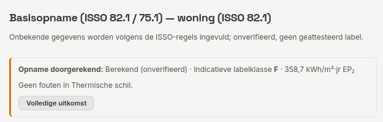

# 2. Basisopname

De basisopname is werkstap 6 **Basisopname** (groep *Bestaande bouw*). Er zijn twee soorten:
- **Woning-opname starten:** voor bestaande woningen, volgens ISSO 82.1, 7e druk met erratum van 6 januari 2026.
- **Utiliteit-opname starten:** voor bestaande utiliteitsgebouwen, volgens ISSO 75.1, 7e druk.

Na het starten loop je de opname door met de voortgangslijst links: Algemeen, (alleen utiliteit) Rekenzones, Thermische schil, Verwarming, Warm tapwater, Ventilatie, Koeling, Zonnestroom (PV) en **Uitkomst & forfaitair**. **Vorige** en **Volgende** gaan een onderdeel terug of verder. **Opname verwijderen** haalt de hele opname uit het project, na een bevestiging. Foto's en andere bestanden die aan de opname gekoppeld waren, blijven in het bewijsregister, als "niet gekoppeld"; het venster noemt hoeveel het er zijn.

De opname wordt bij het project bewaard (blok `basisopname`). De kern zet de opname om in NTA 8800-invoer en rekent die door met **Opname doorrekenen**, in de uitgave van NTA 8800 die het project gebruikt (zie [hoofdstuk 8](08-versies-en-verwijzingen.md)). Na het doorrekenen toont de voortgangslijst per onderdeel het aantal fouten. Bovenaan het onderdeel waar je staat verschijnt meteen de uitkomst: de status, het indicatieve label en EP₂, de fouten van dat onderdeel met **Ga naar het veld**, en hoeveel fouten er in andere onderdelen staan. **Volledige uitkomst** opent **Uitkomst & forfaitair**. De kaart *Uitkomst opname* rechts toont hetzelfde in het kort, met **Overnemen in projectmodel**. De volledige uitkomst (status, uitgave, label en BENG 1–3, de toegepaste standaardwaarden en alle meldingen) staat onder **Uitkomst & forfaitair**. Die uitkomst staat los van de projectberekening: het is een aparte, op de opname gebaseerde uitkomst. De uitkomst blijft per document bewaard zolang je de opname niet wijzigt: wie naar een andere stap of een ander document gaat en terugkomt, ziet haar weer. Een wijziging in de opname of een andere NTA 8800-uitgave voor het project laat de uitkomst vervallen; dan is opnieuw **Opname doorrekenen** nodig. Een reden bij een toegepaste standaardwaarde is documentatie en laat de uitkomst staan. Bij het sluiten of opnieuw openen van het bestand wordt de uitkomst niet bewaard.

**Volgorde van bronnen.** Volgens het wijzigingsdocument v1.1 (p. 6) zitten de wijzigingen daarvan in de 7e druk. Waar de bronnen verschillen, geldt daarom de 7e druk met het erratum. De keuzes per tabel staan in [`docs/nta8800-basisopname.md`](../nta8800-basisopname.md).

## Woningopname (ISSO 82.1)

De opname heeft deze onderdelen:

| Onderdeel | Inhoud | Bron |
|---|---|---|
| Algemeen | bouwjaar, woningtype (eengezinswoning of appartement), ligging en daktype of positie in het bouwblok, gebruiksoppervlakte, bouwlagen, vloer- en wandconstructie (licht, zwaar, zeer zwaar), lichter plafond, een gemeten q_v10 (NEN 2686) | ISSO 82.1 hoofdstuk 6 en 7 |
| Thermische schil | vlakken met isolatie (aanwezig, dikte, renovatiejaar), ramen en deuren met beglazing, zonwerende beglazing met productgegevens | hoofdstuk 8, tabellen 8.9–8.17 |
| Verwarming | opwekker (ketel, warmtepomp, lokale verwarming, luchtverwarmer, collectief), ontwerpklasse (tabel 9.9), distributie (leidingisolatie, eenpijps), afgifte. Bij een ketel en een warmtepomp het **Fabricagejaar** en **Installatiejaar**: onder 2020+A1 bepalen ze de hulpenergie van 9.85 (fabricagejaar, anders installatiejaar, anders het bouwjaar; ISSO 82.1 p. 28). Onder de latere uitgaven heeft het jaar van de warmtepomp geen invloed | hoofdstuk 9 |
| Ventilatie | systeem (A–E), regelingen (tabellen 11.4–11.6), WTW met bypass, ventilatoren, roosterverwarming, passieve koeling. Is het fabricagejaar van de ventilatoren onbekend, dan neemt de opname het bouwjaar, en voor een gebouw van vóór 1900 het jaar 1900 (de oudste rijen van tabel 11.20 en 11.23 gelden toch al voor alle eerdere jaren). Een opgegeven fabricagejaar buiten 1900–2100 geeft een melding | hoofdstuk 11 |
| Warm tapwater | toestel, opslag, douche-WTW, aantal douches, aangesloten badkamers en keukens (13.19a) | hoofdstuk 13 |
| Ruimtekoeling | opwekker en afgifte | hoofdstuk 10 |
| Zonnestroom (PV) | panelen, oriëntatie, helling | ISSO-hoofdstuk over zonne-energie; NTA hoofdstuk 16 |

**Nieuwe vragen in het formulier (9 oktober 2026).** Wat eerder alleen via de JSON-weergave kon, staat nu in de wizard: het ventilatieprincipe (A–D) met zelfregelende roosters, drukklasse, installatie- en fabricagejaar, motor en een aangetoonde variant van tabel 11.5; de ruimtetemperatuurregeling en de leidingen in onverwarmde ruimten (afb. 9.1); deuren met isolatie, glasaandeel en kozijn; alle glassoorten van tabel 7.8 (ook gecoat, met voorzetraam, glas-in-lood en glazen bouwstenen); bij een vlak de dikte van een rieten dak, een geïsoleerde kruipruimtebodem, aangetoonde isolatiedikte en een onverwarmde ruimte als grens. Een onverwarmde ruimte als grens kies je pas nadat je haar onder *Onverwarmde ruimten* hebt toegevoegd; bij een deur met een glasaandeel vraagt het formulier ook de glassoort. Lege verplichte getallen (zoals een gemeten q_v10 of het vermogen van een verlichtingszone) noemt *Opname doorrekenen* bij naam voordat de kern rekent.

**Ook in het formulier (9 oktober 2026, middag).** De laatste vragen die alleen via JSON konden, hebben nu een veld, in beide opnames:
- **Algemeen:** de bron van de gebruiksoppervlakte (NEN 2580) en gebouwgebonden opslag (§15.5). Opslag vraagt het formulier alleen als er PV is, want zonder PV telt ze niet (`storage_requires_pv`).
- **Schil:** per vlak de oriëntatie (niet bij een vloer), de hellingshoek (leeg = 90° gevel, 0° dak), een spouw, en bij een vloer op grond, boven een kruipruimte of onverwarmde kelder de omtrek langs de buitenlucht; onder NTA 8800:2022 en 2020+A1 bij een vloer boven een kruipruimte of onverwarmde kelder ook **Hoogte H2** (bovenkant begane grondvloer tot maaiveld, ISSO 82.1 4e druk afb. 8.23), die die uitgaven als h in (8.47) gebruiken; zonder H2 rekent de opname in die uitgaven niet, vanaf 2023 vraagt het formulier H2 niet; een geveldeel dat aan de **grond** grenst (een kelder- of souterrainwand) krijgt **Hoogte H1** (bovenkant vloer tot maaiveld, ISSO 82.1 7e druk §8.4, p. 74–75) en de vloer waar het bij hoort (te kiezen als er meer vloeren aan grond, kruipruimte of kelder zijn); die vloer rekent dan als verwarmde kelder (NTA 8800 8.3.3.2), met z uit H1 en het geveldeel als keldermuur; een dak kan niet aan de grond grenzen; panelen in een vlak (isolatie, spouw, kozijn); per raam opgegeven belemmeringsfactoren (§17.3, 12 voor verwarming en 12 voor koeling) in plaats van een situatie.
- **Verwarming:** waterzijdig ingeregeld en het aantal bouwlagen dat de distributie bedient (9.37).
- **Ventilatie:** bij gebalanceerde ventilatie de bypass op de warmteterugwinning; in de utiliteitsopname of de luchtbehandelingskast binnen de thermische zone staat.
- **Tapwater:** de douche-WTW (tabel 13.16); in de woningopname de tappunten die de opwekker bedient met de leidinglengtes naar keuken en badruimte; in de utiliteitsopname de circulatieleiding en de voorraadvaten (energielabel, fabricage vanaf 2018, aansluitleidingen, binnen de thermische zone).
- **Koeling (utiliteit):** ontwerptemperatuur van de afgifte, regeling en leidingisolatie.
- **PV:** de ventilatie achter de modules (tabel 16.2), de amorfe moduletypen, en opgegeven belemmeringsfactoren F_sh;obst (één waarde of twaalf) in plaats van een situatie.

Factoren per maand vul je in als lijst gescheiden door puntkomma's, met een komma als decimaalteken.

**Vlakken van de schil.** Een nieuwe opname begint met de vlakken van een voorbeeldwoning. Met **Vlak toevoegen** voeg je een vlak toe (eerst een ongeïsoleerde gevel aan buitenlucht, `vlak-<n>`); vul daarna element, grens, oppervlakte en isolatie in. **Naam van het vlak** wijzigt de id: ramen, deuren, panelen en lichtkoepels in dat vlak, de vloer bij een geveldeel tegen de grond en de gekoppelde foto's gaan mee. Een lege of dubbele naam meldt het formulier; de verwijzingen blijven dan bij de laatste goede naam tot de naam weer uniek is. Hetzelfde geldt voor **Naam van de zone** in de utiliteitsopname. **Vlak verwijderen** kan pas als er geen raam, deur, paneel of lichtkoepel meer in het vlak ligt; verplaats of verwijder die eerst.

**JSON-weergave.** Onder Uitkomst & forfaitair staat de hele opname als JSON. **JSON toepassen** neemt alleen één JSON-object over. Is de opname intussen in een ander onderdeel gewijzigd, dan meldt de weergave dat toepassen die wijzigingen overschrijft; **JSON opnieuw laden** haalt de actuele opname op.

**Standaardwaarden.** Een vraag zonder antwoord krijgt de standaardwaarde uit de ISSO-tabel. Elke toegepaste standaardwaarde verschijnt onder Uitkomst & forfaitair in de lijst "Toegepaste standaardwaarden". Leg per regel de reden vast in het veld **Reden inklappen**. Het projectdossier toetst die redenen; zie [hoofdstuk 7](07-herlabelen-registratie-dossier.md).

**Meldingen die vaak voorkomen**
- **Warmtepomp boven 70 °C** (`heat_pump_above_70_requires_declaration`, erratum §4): geef een gecontroleerde verklaring op.
- **Collectieve bron zonder bewijs** (`collective_source_reference_required`): vul de bronvermelding in.
- **Gesloten of verlaagd plafond** in de woningopname (`closed_ceiling_not_in_dwelling_survey`): dit is een ISSO 75.1-gegeven en hoort hier niet.
- **Systeem E zonder warmteterugwinning** (`combined_requires_heat_recovery`, §11.3.6).

## Utiliteitsopname (ISSO 75.1)

**Algemeen**
- Bouwjaar, aantal bouwlagen en gebouwhoogte.
- **Gebruiksfuncties van het gebouw**: functies met oppervlakte en het totaal.
- Fossiele brandstof op het perceel.
- Oppervlakte van sport- en zwemzalen.

De overige onderdelen volgen ISSO 75.1:
- thermische schil;
- verwarming, met BACS-bepaling uit de opgenomen vermogens (tabel 7.3, p. 62–63);
- ventilatie met luchtbehandelingskast;
- koeling;
- warm tapwater;
- verlichting: per verlichtingszone het oppervlak, het vermogen per armatuur of per lamp (met lamptype), of onbekend met "LED vanaf 2017", de aanwezigheids- en daglichtregeling, grote kantoortuin en afgezogen armaturen;
- bevochtiging (soort bevochtiger, sorptiewiel), en bij de ventilatie recirculatie, volumestroomregeling, LUKA-klasse van de kanalen en de kanalen van de luchtbehandelingskast;
- gebouwautomatisering (GBS) met klasse C/B, collectieve verwarmingsinstallatie, ramen met zonwerend glas en het gebouwtype (één of meer bouwlagen, deel van een gebouw);
- PV.

### Rekenzones (§6.5, afb. 6.6 met tabel 6.4)

Kleine functies (tot 25 %) worden samengevoegd met de hoofdfunctie (p. 39–40). Volgens afb. 6.6 en tabel 6.4 (p. 53–54) moet een gebouw soms toch in meer rekenzones worden opgedeeld:
- bij een verschil in instelwaarde van meer dan 4 K;
- bij een verschil in ventilatiecapaciteit van meer dan een factor 4.

Zonder zones meldt de opname dan `calculation_zone_split_required`.

Zo deel je het gebouw op:
1. Open **Rekenzones (§6.5)** en voeg per zone een id en de gebruiksfuncties met oppervlakte toe. De zones moeten samen de functies van het gebouw dekken.
2. Ken vlakken toe aan een zone met de zonekeuze per vlak. Een vlak zonder zone wordt naar A_g over de zones verdeeld.
3. Geef per verlichtingszone de rekenzone op.
4. Geef per zone eventueel de geïnstalleerde ventilatiecapaciteit op (p. 147). Een zone zonder eigen waarde krijgt naar A_g een deel van het restant.
5. Geef per zone eventueel het oppervlak van de zwemzaal (p. 65) en het decentrale deel van systeem E op (p. 145).

Elke zone moet zelf weer aan afb. 6.6 voldoen (`calculation_zone_criteria_not_met`). Een functie die een eigen zone heeft, wordt ook in de zone van de hoofdfunctie niet samengevoegd. Dat kan in die zone een extra zonesplitsing vragen.

**Beperkingen**
- Eén ventilatiesysteem bedient alle zones.
- Het criterium voor de specifieke interne warmtecapaciteit wordt niet getoetst, omdat de opname één constructie per gebouw kent.

**Meldingen die vaak voorkomen**
- **Ontbrekend bewijs voor inregeling van koeling** (NTA 8800 tabel 10.11, voetnoot a, p. 388): geef een verklaring op, anders telt de inregeling als niet uitgevoerd.
- **Oppervlak zwemzaal zonder zone** (`swimming_pool_zone_required`): bij meerdere sportzones moet de zone worden gekozen.
- **Kleine oude gasmotor** (`gas_engine_small_old_no_table_row`): tabel 9.31 heeft hiervoor geen rij.

## Foto's bij de opname

Elk opname-onderdeel heeft een blok **Foto's**:
- vlakken, ramen, lichtkoepels en PV-velden;
- de opwekker van verwarming en tapwater, en extra opwekkers;
- zonneboilers, ventilatie en koeling.

**Foto toevoegen** opent de bestandskiezer; op een tablet of telefoon ook de camera. Elke foto gaat met zijn SHA-256 in het bewijsregister (soort *Detailfoto*), ook HEIC/HEIF van een telefoon en TIFF of BMP. Kan het programma zo'n foto niet tonen, dan staat er een paperclip in plaats van een voorbeeld; het bestand zelf blijft ongewijzigd. Hij wordt gekoppeld aan het onderdeel, bijvoorbeeld `/basisopname/survey/pv/@pv-1` (het PV-veld met id `pv-1`). Met **Bestaand bewijsstuk koppelen** koppel je een foto die al in het register staat; met het kruisje ontkoppel je hem weer.

De foto's gaan mee in de dossier-ZIP (BRL 9500 bijlage 3: leesbare foto's van typeaanduiding en maatvoering). In de browser blijven de bestanden alleen in deze sessie bewaard. Exporteer daarom het dossier voordat je het venster sluit. De desktopapp bewaart ze in de app-map.

Een koppeling verwijst naar het id van het onderdeel, zoals de id van een vlak, raam, lichtkoepel, PV-veld, zonneboiler, extra opwekker of extra tapwatersysteem. Verwijder of verplaats je een ander onderdeel, dan blijft de foto bij zijn eigen onderdeel. Een extra opwekker of extra tapwatersysteem krijgt bij het toevoegen een id (`opwekker-1`, `tapwateropwekker-1`, `tapwatersysteem-1`); een opname uit een eerdere versie krijgt die ids bij het openen, en de koppelingen gaan dan mee. De rekenkern gebruikt de ids niet in de berekening; twee gelijke ids in één lijst of een lege id geeft een melding. Verwijder je een onderdeel, dan vervallen de koppelingen naar dat onderdeel; de foto's blijven in het register als "niet gekoppeld".

## Overnemen in projectmodel

Na **Opname doorrekenen** staat de knop **Overnemen in projectmodel** onder Uitkomst & forfaitair en in de kaart *Uitkomst opname* naast elk onderdeel. Hij werkt alleen bij een berekende opname met afgeleide NTA-invoer; anders vraagt de knop eerst de opname door te rekenen. Die zet de NTA-invoer die de kern uit de opname afleidde in het concept van de NTA-invoer. Eerst toont een venster per invoer de huidige waarde en de waarde uit de opname.

| Overgenomen | Niet overgenomen |
|---|---|
| verwarming (opwekker, distributie met het distributiesysteem, afgifte, collectieve aansluiting), bevochtiging, tapwater, koeling, ventilatie, PV, verlichting, BACS, gebruiksfunctie, instelwaarden, thermische massa en interne warmte | geometrie en oppervlakten: zones, vlakken en ramen blijven die van het projectmodel |
| het bouwjaar, en de label- en Bbl-functie als de opname die geeft | de NTA 8800-uitgave: die blijft die van het project |
| per aangevinkte waarde: de gegevens van een vloer op de grond (zie hieronder) | bij een opname met meer rekenzones: de zonegegevens (setpoints, massa, interne warmte, ventilatie) |
| | aanvullende verwarmingssystemen; de vraag of de vergunning na 29 mei 2026 is aangevraagd |

De verlichting, de bevochtiging, het tapwater en de ventilatie volgens hoofdstuk 11 horen bij de eerste rekenzone van het projectmodel. Ze krijgen bij het overnemen die zone en haar gebruiksoppervlakte: de oppervlakten uit de opname (verlichtingszones, functieoppervlakten van de verlichting en het tapwater, bediende oppervlakte van een bevochtiger) worden naar verhouding omgerekend naar de oppervlakte van die zone. Het tapwater dient het hele gebouw: heeft het project meer rekenzones, dan worden de functieoppervlakten van het tapwater omgerekend naar de gebruiksoppervlakte van alle zones samen. Neemt de opname BACS-gegevens over (f_BACS), dan vervalt een eigen BACS-inventaris van het project; die hoort bij de installaties die het overnemen vervangt.

**Vloeren op de grond.** Omdat de geometrie die van het projectmodel blijft, gaan de vloergegevens van de opname alleen mee in de grondvloergegevens van een vloer uit het projectmodel (Gebouw › Schil & ramen, *Vloeren op grond (§8.3)*). Het venster toont daarvoor per opnamevloer het deel *Vloeren op de grond*:

- **Koppelen.** Kies bij elke opnamevloer de vloer van het projectmodel waar hij bij hoort. Het programma stelt een vloer voor: dezelfde id, anders de enige vloer op de grond aan beide kanten, anders de enige vloer met dezelfde oppervlakte (±2 %). Kies *niet overnemen* om een opnamevloer over te slaan.
- **Per waarde aanvinken.** De lijst toont wat er verandert: omtrek P, R_c van de vloer, de randkoudebruggen, randisolatie, een kruipruimte of onverwarmde kelder (8.3.4.2) en een verwarmde kelder (8.3.3.2) met diepte, wandoppervlakte en R_c van de kelderwanden. Een geveldeel tegen de grond uit de opname komt zo als verwarmde kelder in het project.
- **Nooit ongevraagd overschreven.** Een waarde die het project nog niet heeft, staat aangevinkt. Heeft het project al een andere waarde, dan staat er *het project heeft een andere waarde* en is de regel niet aangevinkt; die neem je alleen over door hem aan te vinken. Heeft de opname bij een vloer geen kruipruimte, randisolatie of verwarmde kelder en het project wel, dan biedt de lijst *verwijderen* aan, ook alleen na aanvinken.
- **ΔU_for van de kelderwanden** neemt het venster niet over: de kern leidt hem af uit de schil van het projectmodel (8.38 met 8.2.1).
- **Bron.** De bronverwijzing van de projectvloer krijgt "basisopname, vloer <id>" met de bron van de opnamevloer erbij, achter een bron die er al stond.

Rekent het project daarna met een vloer van dezelfde oppervlakte als de opnamevloer, dan is de warmteoverdracht naar de grond gelijk aan die in de opname (getoetst in `crates/nta8800-core/tests/survey_takeover.rs`).

**Koudebrugmethode van het gebouw.** De opname rekent met forfaitaire lineaire koudebruggen: ΔU_for (8.3) op de buitenconstructies, en bij een vloer op de grond 0,5·P. Het venster stelt daarom ook *Lineaire koudebruggen van het gebouw (8.2.1)* op *Forfaitair* voor, zodat een woning zonder vloer op de grond (bijvoorbeeld een bovenwoning) in het project dezelfde methode krijgt. Heeft het project nog geen methode, dan staat het voorstel aangevinkt. Kiest het project al ψ-waarden per koudebrug, heeft een vloer een gedetailleerde vloerrand, of staan er koudebruggen met ψ in de zones, dan staat het voorstel niet aangevinkt: forfaitair mag niet samen met ψ-waarden (8.2.1). Je neemt het dan alleen bewust over, en past daarna de vloerrand of de koudebruggen aan.

**Overnemen in concept** past nog niets toe. De toepasbalk onderaan toont de wijzigingen, met **Ongedaan maken** en **Toepassen**. De normversie van het concept blijft staan.

## Invoergrenzen

Beide opnames weigeren onmogelijke aantallen en maten:

| Gegeven | Grens | Melding |
|---|---|---|
| bouwlagen | meer dan 200 | `storeys_out_of_range` |
| andere aantallen | meer dan 100.000 | `count_out_of_range` |
| oppervlakten | meer dan 10⁷ m² | `area_out_of_range` |
| gebouwhoogte | ontbreekt, 0 of meer dan 1000 m | `building_height_invalid` |

Dit zijn keuzes van het programma, geen normwaarden.
