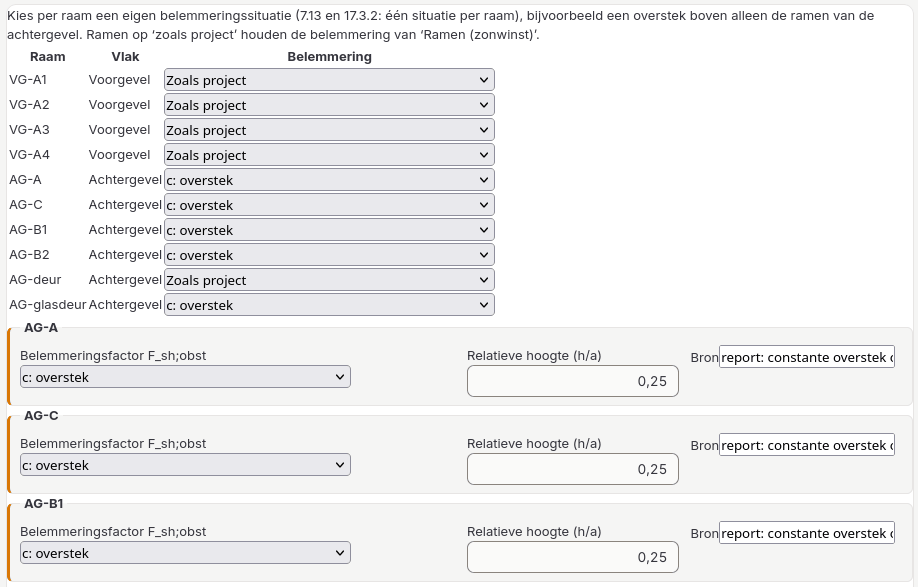
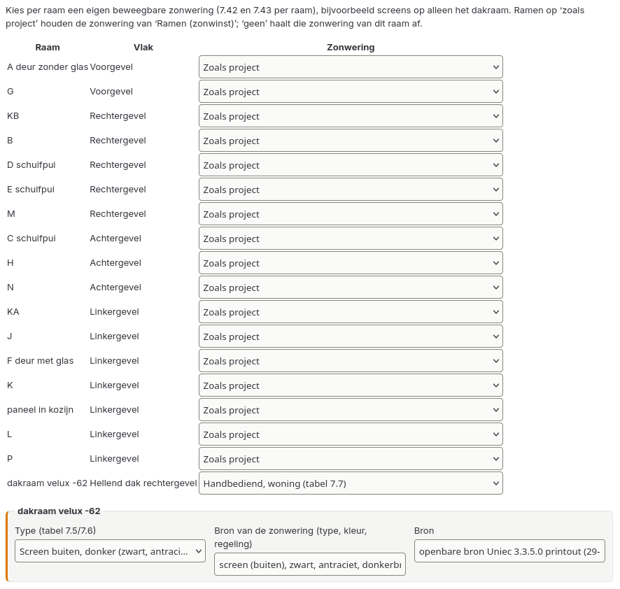
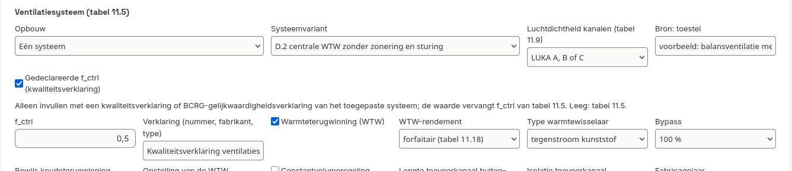
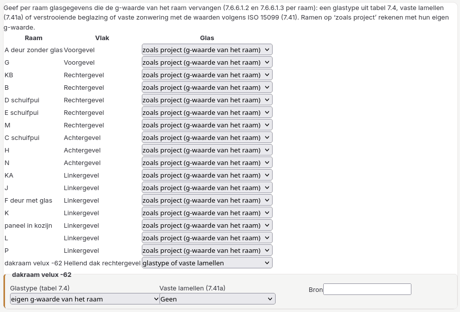
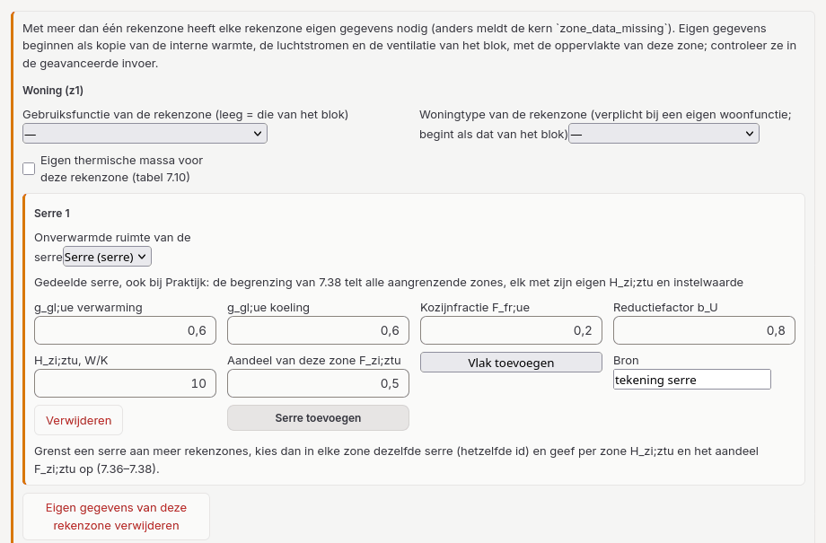
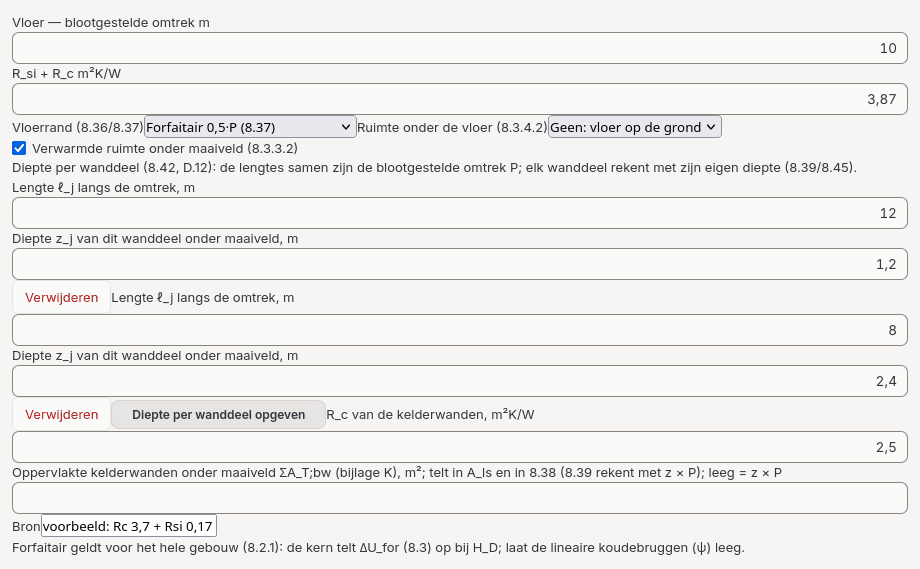
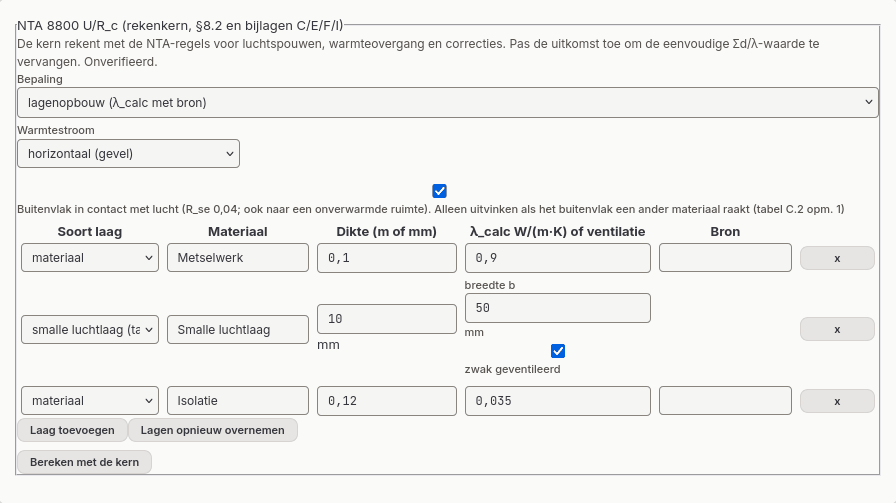
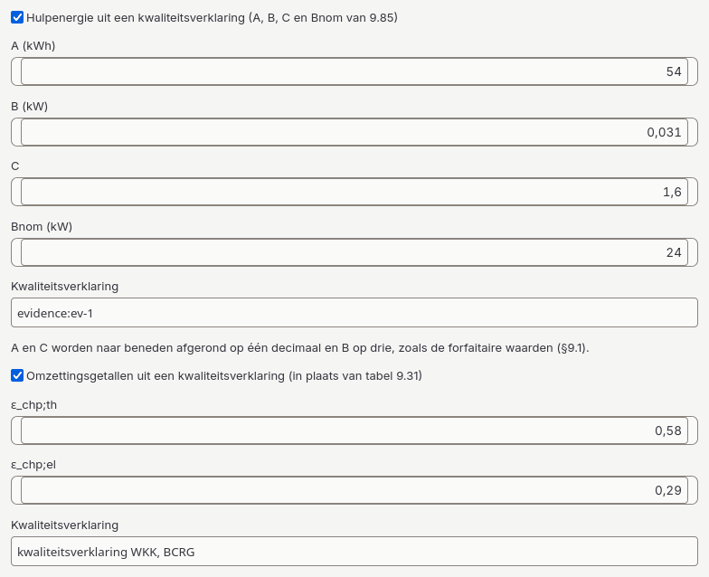
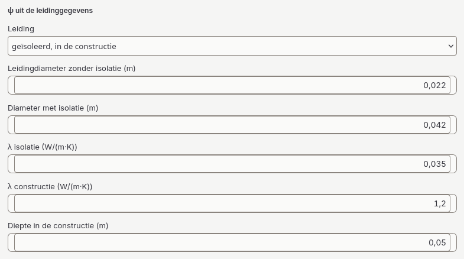
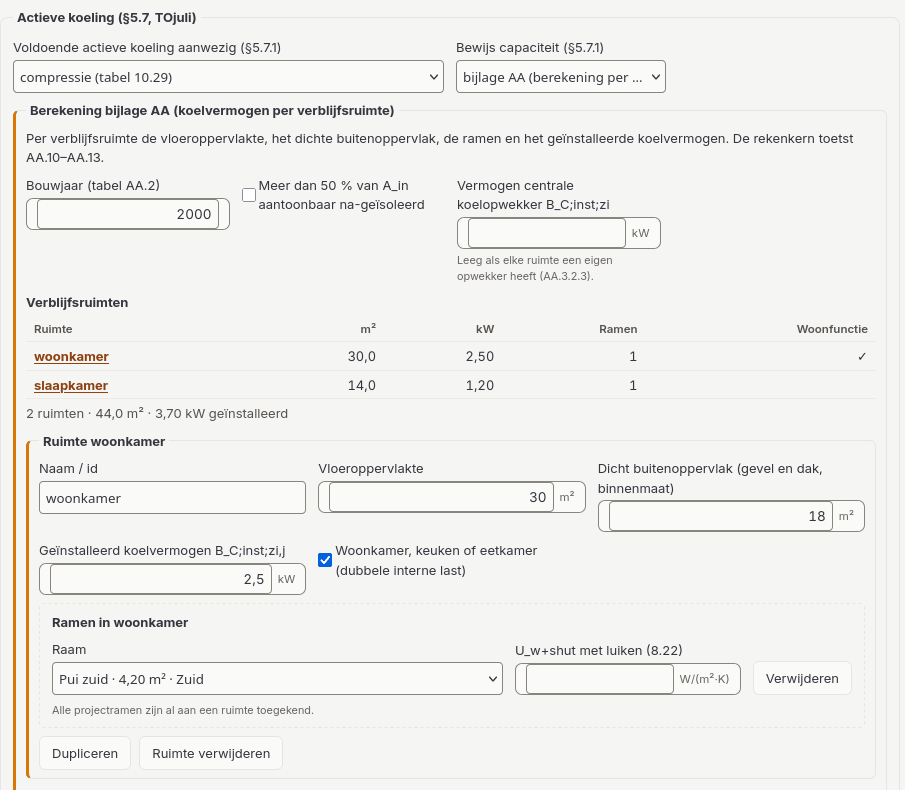

# 3. Projectberekening

Een projectberekening (detailopname of nieuwbouw) bestaat uit twee lagen:

1. **Het projectmodel**: zones, vlakken, ramen, constructies, koudebruggen, onverwarmde ruimten en installaties. Je bouwt het op onder de werkstappen *Gebouw* (tabel *Schil & ramen*, rekenzones, constructies, koudebruggen, luchtdichtheid, onverwarmde ruimten) en *Installaties*.
2. **Het NTA-invoerblok** (`ntaCalculation`): de NTA 8800-gegevens die het projectmodel nog niet heeft. Je begint het met **NTA-invoer starten** op de stap Project. De secties staan daarna onder de werkstappen waar ze horen, in het blok *NTA 8800-invoer* onder aan elke pagina.

Elke opgegeven waarde vraagt een bron, zoals een tekening, productblad, normtabel of opnamerapport. Een leeg veld wordt nooit stilzwijgend aangevuld. Het blijft een invoergat (zie [hoofdstuk 5](05-validatie.md)).

## Het projectmodel

| Element | Wat vastleggen | Normbasis |
|---|---|---|
| Zone | gebruiksoppervlakte A_g, volume, bouwlagen | §6.6 |
| Vlak | thermische begrenzing (buitenlucht, grond, onverwarmde ruimte, aangrenzend verwarmd, intern), oriëntatie, constructie | §6.7, §8.2 |
| Constructie | U-waarde, of R_c uit lagen via **Constructie bewerken**: het onderdeel *NTA 8800 U/R_c* rekent met de kern (bijlage C, forfaitair bijlage I). Een niet-geventileerde luchtspouw dunner dan 20 mm zonder reflecterende laag rekent de kern zelf (bijlage D.2 van NEN-EN-ISO 6946, voetnoten c en e van tabel C.3/C.4); een zwak geventileerde smalle luchtlaag in een constructie met U ≤ 1,0 kies je als laagsoort *smalle luchtlaag (tabel F.1)* met **zwak geventileerd** (halve tabelwaarde, F.2); een reflecterende dunne spouw geef je op als R-waarde met bron | §8.2, bijlagen C en I |
| Raam | oppervlakte, U, g (loodrecht) | §7.6, §8.2 |
| Koudebrug | lineair (ψ, lengte) en puntvormig (χ), met begrenzing | §8.2 |
| Onverwarmde ruimte | reductiefactor b met bron, of afgeleid via de NTA-invoer. Ook te combineren met forfaitaire koudebruggen (zie [hieronder](#forfaitaire-koudebruggen-met-een-onverwarmde-ruimte)) | §8.4 (8.53–8.59) |
| PV-systeem | panelen of oppervlak, oriëntatie, helling | hoofdstuk 16 |

**Bewerken en verwijderen.**
- Elke rij in de envelopweergave heeft de knoppen **Bewerken** en **Verwijderen**; dubbelklikken opent de editor.
- Bewerken laat id's en volgorde gelijk.
- Verwijderen vraagt om bevestiging. Wat wegvalt, staat in de bevestiging, en de NTA-invoer verliest meteen de verwijzingen naar het verwijderde onderdeel:
  - zonegegevens;
  - dynamische ramen;
  - vloeren op grond;
  - dakhellingen;
  - de zones van installaties.
- Een constructie die nog in gebruik is, kan niet worden verwijderd.
- Een verwijdering die de paden van een handmatige maatwerkadviesmaatregel zou verschuiven, wordt geweigerd.

## Hulppanelen

Naast de NTA-invoer zijn er vier hulppanelen. Ze staan bij de stap waar ze inhoudelijk horen:
- *Invoercontrole*: Controle › Controleoverzicht;
- *Onverwarmde ruimtes*: Gebouw › Onverwarmde ruimten;
- *NTA-warmtepompen* en de *gaswarmtepomp-referentievergelijking* (uitklapbaar): Installaties › Warmtepompen.

- **Invoercontrole.** Een structuurcontrole van het projectmodel door de rekenkern: fouten, aandachtspunten en de indeling van de warmtepompen. Het paneel toont ook de herkomst van de controle (doelnorm, rekenkernversie en invoervingerafdruk). Het is geen NTA 8800-berekening en geen energielabel.
- **Onverwarmde ruimtes.** Hier leg je per onverwarmde ruimte een reductiefactor b (0 t/m 1) met een bron vast. Een afgeleide b_U (8.53–8.59) geef je op via de NTA-invoer. Het paneel toont ook een diagnose van de transmissie via deze ruimtes (A·U, L·Ψ en χ met de opgegeven b); die diagnose is geen geverifieerde uitkomst.
- **NTA-warmtepompen.** Een lijst van losse warmtepompen met brontype en bediende zones. De invoercontrole classificeert ze, maar de energieberekening gebruikt ze niet: die rekent met de opwekkers uit het NTA-invoerformulier. Bij het verwijderen van een zone verdwijnt die zone uit de lijst van bediende zones.
- **Gaswarmtepomp-referentievergelijking.** Je laadt een case met 25 verwachte waarden (een synthetisch voorbeeld of een eigen JSON-bestand) en vergelijkt die met de conceptberekening voor gaswarmtepompen. Een overeenkomst bewijst geen NTA-conformiteit en levert geen BENG-uitkomst of label op.

## Het NTA-invoerformulier

Het formulier vraagt alleen wat het projectmodel nog niet heeft. De secties staan verdeeld over de werkstappen (zie [hoofdstuk 0](00-werken-met-het-programma.md#nta-invoer-in-de-stappen)); Controle › NTA-invoer toont de overige secties en het paneel *NTA 8800-berekening (rekenkern)*. Wijzigingen gaan in één concept; **Toepassen** in de toepasbalk onderaan schrijft ze in het project, **Ongedaan maken** draait de laatste wijziging terug. Lege velden staan na het formulier in de melding **Nog leeg (n): …**. Ze gaan niet mee naar de rekenkern; een verplicht veld verschijnt na de berekening als invoergat.

| Onderdeel | Inhoud | Normbasis |
|---|---|---|
| Algemeen | rekenscope (woningbouw of utiliteit), bouwjaar, bron A_g, gebruiksfunctie en woningtype, Bbl-functie, actieve koeling (systeem, capaciteitsbewijs of bijlage AA, zie [hieronder](#koelvermogen-volgens-bijlage-aa)), vergunningaanvraag na 29 mei 2026, fossiele toestellen buiten de berekening | tabellen 7.13–7.15, §5.7.1, bijlage AA |
| Gebruiksfuncties met oppervlakte | functies voor gemengde rekenzones, Bbl-toets en labelklasse | §6.5.3, Bbl art. 4.149 lid 2 |
| Instelwaarden (tabel 7.13) | instelwaarden voor verwarmen en koelen; het formulier toetst per zone aan tabel 7.13 (gewogen bij meerdere functies), knop "Tabelwaarden gebruiken" | tabel 7.13 |
| Thermische massa (tabel 7.10) | klasse vloer en wand, plafondkolom; alleen onder 2022 en 2020+A1 ook de massa per m² gebruiksoppervlakte (kg/m²) | tabellen 7.10–7.12 |
| Gegevens per rekenzone (Gebouw › Rekenzones; bij utiliteit ook bij één rekenzone) | per rekenzone **Eigen gegevens voor deze rekenzone**: gebruiksfunctie en woningtype (leeg = die van het blok), delen met een andere gebruiksfunctie en hun oppervlakte, gemeenschappelijke ruimten (zie [hieronder](#gemeenschappelijke-ruimten-664)), eigen thermische massa, serres, en bij een sportfunctie in de ventilatie een zwembad. Eigen gegevens beginnen als kopie van de interne warmte, de luchtstromen en de ventilatie van het blok, want de kern neemt die dan alleen uit de zone; pas ze per zone aan | §6.3, §6.5.3, 6.6.4, tabel 7.10, 7.30b |
| Interne warmtewinst | aantal woningen; bij utiliteit de tabelmethode of een opgegeven W/m² | 7.21–7.29, tabellen 7.2/7.3 |
| Ramen (zonwinst) | kozijnfractie, belemmering, beweegbare zonwering (F_c, bediening) | §7.6, §17.3, 7.42/7.43 |
| Belemmering per raam (Gebouw › Schil & ramen) | per buitenraam "Zoals project" of een eigen situatie a–g of opgegeven factoren, met bron; een raam dat niet meer in het project staat, wordt gemeld met **Verwijderen** | 7.13, §17.3.2 |
| Zonwering per raam (Gebouw › Schil & ramen) | per buitenraam "Zoals project", "Geen" of een eigen beweegbare zonwering: de bediening (tabel 7.7–7.9), het type uit tabel 7.5/7.6 of een eigen F_c, en de bron; bijvoorbeeld screens op alleen het dakraam | 7.42, 7.43 |
| Glas per raam (Gebouw › Schil & ramen) | per buitenraam "zoals project" (de g-waarde van het raam), een glastype van tabel 7.4 en/of vaste lamellen (7.41a), of verstrooiende beglazing of vaste zonwering met g_gl,alt en g_gl,dif volgens ISO 15099 (7.41), met bron | 7.6.6.1.2, 7.6.6.1.3, 7.41 |
| Dynamische ramen (bijlage A) | per buitenraam methode A (toestanden met gewichten) of B, correctie stap 2 | bijlage A (p. 766–771) |
| Aangrenzende onverwarmde serres (7.30b) | serre en de vlakken ervan; heeft het project onverwarmde ruimten, dan kies je de serre uit die lijst. Grenst de serre aan meer rekenzones, kies dan bij **Eigen gegevens voor deze rekenzone** in elke zone dezelfde serre, met per zone H_zi;ztu en de verdeelfactor F (7.36). Het formulier toont dan *Gedeelde serre, ook bij …*, en de begrenzing van 7.38 telt alle aangrenzende zones, elk met zijn eigen instelwaarde. Een nieuwe serre krijgt een id dat nog niet in gebruik is, zodat twee zones niet per ongeluk één serre delen. De scheiding naar de serre en haar ramen krijgen geen eigen zonnewinst (melding, vraag 11 aan NEN) | 7.30b, 7.36–7.38 |
| Dakhellingen | helling per hellend dakvlak | tabel 17.2 |
| Vloeren op grond (§8.3) | blootgestelde omtrek, R_si + R_c, vloerrand (ψ of forfait), kruipruimte of onverwarmde kelder, verwarmde kelder, randisolatie; onder 2022 en 2020+A1 bij een kruipruimte of kelder ook de wandhoogte h boven maaiveld (8.47). Een verwarmde vloer die zelf onder maaiveld ligt en een kruipruimte of onverwarmde kelder onder zich heeft, geef je op als kruipruimte of kelder plus *verwarmde kelder* met de werkelijke diepte (zie [hieronder](#verwarmde-vloer-onder-maaiveld-boven-een-kruipruimte)). Ligt de kelderwand niet overal even diep, kies dan **Diepte per wanddeel opgeven** en geef per wanddeel de lengte ℓ_j langs de omtrek en de diepte z_j; de lengtes samen zijn P, en elk deel rekent met zijn eigen diepte (8.39, 8.42, 8.45). Bij een verwarmde kelder kun je de **oppervlakte van de kelderwanden onder maaiveld ΣA_T;bw** (bijlage K) opgeven; die telt in A_ls (6.7.2, f_ls 0,7) en bij een forfaitaire vloerrand in 8.38. Leeg rekent de kern met z × P | §6.7, §8.3, bijlage D, bijlage K |
| Verticale leidingen (7.3.3) | "geen", een lijst, of onbekend (geeft een gat) | §7.3.3 |
| Ventilatie | hoofdstuk 11 (systeem, WTW, kanalen, LBK, infiltratie, regelingen, passieve koeling), of "H_ve zelf opgeven". Heeft de ventilatie een sportfunctie, dan vraagt het formulier of er een zwembad is (q_usi;spec van sport × 2, §11.2.2.5.1). Bij het systeem kan een **gedeclareerde f_ctrl** uit een kwaliteitsverklaring of BCRG-gelijkwaardigheidsverklaring worden opgegeven, met de verklaring als bron; die vervangt de waarde van tabel 11.5 (niet bij het decentrale deel van E.1). Bij **ventilatieve koeling** met openingen in gevels die minstens 90° verschillen, of in een gevel en het dak, rekent de kern dwarsventilatie; een opening die precies op een sectorgrens van 11.77 staat (bijvoorbeeld noordoost), telt daarbij in één sector, de sector die met de klok mee volgt (α_min ≤ α < α_max) | hoofdstuk 11, tabel 11.5, 11.77 |
| Afgifte en distributie (§9.3/9.4) | afgiftesysteem, inregeling, regeling, ventilatoren in de afgifte, distributie berekend of forfaitair, luchtverwarmers. Bij **Ψ van de leidingen** kies je forfaitair (tabel 9.16) of berekend uit de leidinggegevens (9.33–9.35); bij een collectieve installatie komen daar de afleverset en, alleen met een berekende Ψ, het buffervat bij (tabel 9.16 opmerking 2). Een collectieve installatie met een tapwater-afleverset voert via de verwarmingsleidingen ook warmte voor tapwater (13.4 c): vanaf de uitgave 2024 tellen de leidingen in de verwarmde zone dan mee (L_zi is niet 0) en geldt de rij voor gecombineerde leidingen van tabel 9.16, ook als "De leidingen voeren ook tapwater" niet is aangevinkt. Staan er luchtverwarmers van meer dan één type in de zone (bijvoorbeeld axiale en radiale recirculatieventilatoren), dan telt de hulpenergie per type naar rato van het aantal (9.23): geef het aantal van het eerste type en de overige typen met hun aantal op. ψ van de leidingen kan uit de leidinggegevens worden berekend, ook voor leidingen in de constructie (9.34), met **ψ uit de leidinggegevens** (zie [hieronder](#leidinggegevens)) | §9.3, §9.4, 9.21–9.23, 9.26–9.51 |
| Opwekker | zie hieronder. Bij een gas- of olieketel kan de hulpenergie uit een kwaliteitsverklaring komen: vink **Hulpenergie uit een kwaliteitsverklaring (A, B, C en Bnom van 9.85)** aan. A en C worden naar beneden afgerond op één decimaal en B op drie; de term met B rekent met de brandstofinvoer van de ketel, gas of olie. Bij een WKK met methode 2 kunnen ε_chp;th en ε_chp;el uit een kwaliteitsverklaring de waarden van tabel 9.31 vervangen (**Omzettingsgetallen uit een kwaliteitsverklaring**), naar beneden afgerond op twee decimalen | §9.1, §9.6 |
| BCRG-verklaringstabel | losse controle van een BCRG-tabel; telt niet mee in de projectberekening | — |
| Extra verwarmingssystemen (§9.2) | bij meerdere zones: systemen per zone | §9.2 |
| Warm tapwater (§13) | functie en oppervlakte of aantal woningen, tappunten, leidingen, circulatie, voorraadvaten, toestel; onder 2022 en 2020+A1 ook "elektrische boiler met geïsoleerde leidingen" (f_sto;dis;ls). Bij een circulatieleiding kan ψ uit de leidinggegevens worden berekend (13.27–13.29), bijvoorbeeld voor een leiding in de constructie; de warmteovergangscoëfficiënt ligt daar vast op 8,0 W/(m²·K). Een WKK die ook tapwater levert, kan dezelfde omzettingsgetallen uit een kwaliteitsverklaring gebruiken als bij verwarming. Heeft een WKK voor tapwater een indirect verwarmd voorraadvat, voeg dat vat dan toe met **Vat toevoegen** (inhoud, aansluitfactor, opstelling). De kern rekent het vatverlies volgens 13.6, net als bij een ketel, en telt het één keer op bij de warmte die de WKK moet leveren (13.8.4.7.4). Een boosterwarmtepomp kan forfaitair rekenen (13.162/13.163): kies bij Tapwatertoestel "boosterwarmtepomp, forfaitair (13.162/13.163)" en vul "Ontwerpaanvoertemperatuur van het voedende verwarmingssysteem" in; leeg betekent onbekend, en dan rekent de kern met de ongunstigste waarden (η 1,15, COP 3). Bij "Bron van de warmte (figuur W.1)" kies je externe warmtelevering, het verwarmingssysteem van het gebouw of een collectieve opwekker met zijn opwekkingsrendement en energiedrager. Met meetwaarden (bijlage W) kies je "boosterwarmtepomp met meetwaarden (bijlage W)": de gemeten COP bij 24 °C (of 16 °C) en 40 °C, de klasse, het stilstandsverlies P_ls (W.17) en de brontemperatuur θ_evap, als één waarde of per maand. Ook warmtepompen in serie (13.8.4.10), een warmtepomp met indirect verwarmd vat, een combitoestel op vaste biomassa (tabel 13.22) en een groot direct gestookt voorraadtoestel hebben een eigen keuze. Per tapwatersysteem vul je de afleversets van externe warmtelevering (13.4.2) en de b_U van de onverwarmde ruimte met leidingen of vaten (7.82) in. Verder per tapwatersysteem: de douche-WTW per douche (verbinding en opgegeven rendement), de kokendwaterkraan, en het gasgestookte voorraadtoestel (13.165–13.175) als toestel. **Circulatieleiding aanwezig (§13.5)** opent de circulatie: isolatie (tabel 13.4), buitendiameter, geïsoleerde appendages, lengte (leeg = 13.31), lengte en temperatuur in onverwarmde ruimten (leeg = 15 % en 13 °C), bouwlagen n_si (13.32), sporthal (13.32a), woningen op de circulatie (leeg = gebruiksoppervlakte van het collectieve systeem gedeeld door die van de woning, afgerond; tabel 13.29), een opgegeven Ψ of een berekende Ψ (die sluiten elkaar uit), en de circulatiepomp (regeling volgens tabel 13.6, vermogen volgens het energielabel, EEI). Bij de boosterwarmtepomp met meetwaarden heten de twee beproevingen "beproeving 1 (lage brontemperatuur)" en "beproeving 2 (40 °C)" | hoofdstuk 13 |
| Extra tapwatersystemen (§13.2.4) | meerdere systemen per gebouw; elk met eigen tappunten of oppervlakte, toestel, nominaal vermogen, voorraadvaten, circulatieleiding, extra opwekkers en serieopstelling (alleen met precies één extra opwekker) | §13.2.4, 13.8.2, 13.141a–d |
| Zonneboilers (§13.7) | berekend of getest systeem, PVT | §13.7 |
| Zonneverwarming zonder tapwatersysteem | zonnecombi voor ruimteverwarming | §13.7 |
| Koeling (§10.5) | opwekker (methode 1, 2 of 3), afgifte, distributie; bij meerdere zones meerdere koelsystemen. Bij water als koudedrager kan ψ van de leidingen uit de leidinggegevens worden berekend (10.24–10.26). Is de koeling collectief voor het gebouw, vink dan **Koeling collectief voor het gebouw** aan en geef de gebruiksoppervlakte van het hele gebouw met bron | hoofdstuk 10 |
| Bevochtiging (hoofdstuk 12) | per zone verneveling of stoom, eventueel bediend oppervlak. Bij stoom kies je de **Stoomopwekker**: elektrisch, gas of olie (12.3; de brandstof telt als die energiedrager, tabel 5.2). Een project met de oude keuze "gas of olie" rekent als gas | hoofdstuk 12 |
| Verlichting (hoofdstuk 14), alleen utiliteit | per verlichtingszone vermogen (forfait of armaturen), schakeling, daglicht, parasitair vermogen; daglicht forfaitair (14.43/14.44) of per daglichtsector: verticale ramen, daklichten, een hellend raam (bijlage Y) of een opgegeven F_D;dayl uit een berekening volgens bijlage F van NEN-EN 15193-1:2017 (de alinea onder de tabel met F_D;C, 2025+C1 p. 672). Kies dan bij het type sector **opgegeven F_D;dayl (NEN-EN 15193-1 bijlage F)** en vul de sectoroppervlakte, de factor (0–1) en als bewijs de berekening in. Zo'n sector heeft geen keuze voor de daglichtregeling, want die zit al in de factor. Het programma rondt de factor naar beneden af op twee significante cijfers (0,781 wordt 0,78); onder 2022 en 2020+A1 ook constante-lichtregeling (tabel 14.4); bij meer rekenzones de rekenzone van de verlichting | hoofdstuk 14 |
| PV (§16) | piekvermogen (uit panelen volgens 16.4b, uit tabel 16.1, of een opgegeven K_pk in W/m² volgens 16.4a met het datablad als bron), belemmering per systeem. Een opgegeven K_pk boven 300 W/m² geeft bij registratie een waarschuwing (`plausibility_pv_peak_power`): controleer het datablad. Boven 400 W/m² weigert de kern de invoer (`pv_peak_power_invalid`). Beide grenzen zijn keuzes van het programma; 16.4 stelt geen maximum; een PV-systeem dat het hele gebouw deelt (**PV-systeem gedeeld door het gebouw**) met de gebruiksoppervlakte van het gebouw en bron | hoofdstuk 16, §17.3, 6.6.7 |
| Bevestigingen | f_BACS met bron, BACS-blok, externe levering (bijlage P), alle posten en opwekking opgenomen, opgegeven stromen, C1-ventilatie, opslag | §5.5, §5.8, 5.14a, bijlage P |

### Opwekkers voor ruimteverwarming

Het formulier kent deze opwekkers:
- **Fossiel:** gasketel (forfait), ketel met productgegevens (bijlage M).
- **Elektrisch en warmtepomp:**
  - elektrische warmtepomp, forfaitair (tabellen 9.27/9.29);
  - warmtepomp met productgegevens (bijlage Q);
  - hybride warmtepomp;
  - gaswarmtepomp;
  - elektrische verwarming.
- **Overig:**
  - externe warmtelevering;
  - WKK (tabel 9.31 of methode 1);
  - biomassa;
  - lokale, lucht- of stralingsverwarmer (bijlage N);
  - overige verwarmer (tabel 9.25).
- **Meerdere opwekkers** (9.6.1), met voorkeursvolgorde en geschatte β.

Een warmtepomp volgens bijlage Q in een set bepaalt boven 55 °C zelf zijn aandeel (§9.6.3).

Een systeem voor meer dan 500 m² gebruiksoppervlakte per toestel staat per definitie in een technische ruimte die als aangrenzende ruimte telt (§9.6, tabel 9.25 opmerking b). Een gasketel (ook als bijverwarming van een hybride of bijlage Q-warmtepomp) of een centrale biomassaketel die op **Binnen thermische schil** staat, rekent dan met het rendement van de rij *buiten de thermische begrenzing*, met de melding `generator_large_system_outside`. Bij identieke systemen (§9.1) telt de oppervlakte per toestel.

Onder de uitgave 2020+A1 vraagt de forfaitaire (of hybride) warmtepomp ook het **installatiejaar** met bron. Formule 9.85 van die uitgave neemt A = 13,0 kWh voor een toestel vanaf 2015 en 87,6 kWh voor een ouder of onbekend toestel. Onder de latere uitgaven heeft het jaar geen invloed en is het veld verborgen.

**Invoer die alleen in een uitgave bestaat.** Velden die een andere uitgave niet kent, staan alleen onder die uitgave in het formulier. Kies je een andere uitgave terwijl zo'n veld een waarde heeft, dan toont het formulier een melding met **Verwijderen**; de rekenkern weigert de waarde anders met `route_not_in_edition`. Zie [Normversies](10-normversies.md).

### Opgegeven productwaarden en hun bewijs

Waar het formulier een waarde uit een kwaliteitsverklaring toelaat (§9.1), vervangt die waarde het forfait of de tabelwaarde. Dat geldt onder meer voor:
- de gedeclareerde f_ctrl bij de ventilatie (tabel 11.5);
- A, B, C en B_nom van de ketelhulpenergie (9.85);
- ε_chp;th en ε_chp;el van een WKK (tabel 9.31), voor verwarming en tapwater;
- het opwekkingsrendement van een warmtepomp of tapwatertoestel;
- de belemmering, de zonwering en het glas per raam.

Elke opgegeven waarde vraagt een bron: nummer en uitgever van de verklaring, of de tekening, het productblad of de opname. Leg het bestand zelf vast in het bewijsregister en koppel het aan het veld met **Bron & bewijs** (zie [hoofdstuk 7](07-herlabelen-registratie-dossier.md#bewijsregister)); het projectdossier bevat dan de gebruikte verklaringen (BRL 9500 bijlage 3). Zonder bron geeft de kern een invoergat en gebruikt hij de opgegeven waarde niet.

### Leidinggegevens

Bij distributie (verwarming en koeling) en bij de circulatieleiding van warm tapwater kun je ψ berekenen in plaats van opgeven. Kies onder **ψ uit de leidinggegevens** de soort leiding (*geïsoleerd, in lucht*, *geïsoleerd, in de constructie* of *ongeïsoleerd*) en vul de diameters, de λ-waarden en, bij een leiding in de constructie, de diepte in. Bij koeling kies je daarvoor *berekend uit de leidinggegevens (10.24–10.26)*.
- Alle maten zijn in **meters**: 15 mm is 0,015 m. Een diameter of diepte boven 1 m wordt geweigerd met *Leidinggegevens: een diameter of diepte is groter dan 1 m …*.
- Bij verwarming (9.33–9.35) en koeling (10.24–10.26) mag een eigen warmteovergangscoëfficiënt worden opgegeven; bij tapwater ligt die vast op 8,0 W/(m²·K) (13.27/13.29).
- Bij tapwater geef je ψ óf op óf bereken je hem, niet allebei.

### Koudebrugmethode van het gebouw

Lineaire koudebruggen reken je voor het hele gebouw op één manier (8.2.1): met een ψ-waarde per koudebrug, of forfaitair met de toeslag ΔU_for (8.3) op alle delen van H_D. Kies onder **Lineaire koudebruggen van het gebouw (8.2.1)** in de stap *Gebouw → Schil & ramen*:
- *Volgt de vloerrand van de grondvloeren*: de keuze bij **Vloerrand** van de vloeren op grond beslist, zoals voorheen.
- *Forfaitair: ΔU_for (8.3)*: ook voor een gebouw zonder vloer op de grond, zoals een bovenwoning. Een vloer op grond moet dan ook forfaitair (0,5·P) zijn en de koudebruggenlijst blijft leeg.
- *ψ-waarden per koudebrug (8.1)*: een vloer op grond moet dan ψ-waarden per randdeel hebben.

Kiezen de vloerrand en het gebouw verschillend, dan meldt de kern `thermal_bridge_methods_mixed`.

De koudebrug van de vloerrand naar de grond (ψ_gr, 8.36/8.39) hoort bij de vloer op grond, niet in de koudebruggenlijst van de zone; een koudebrug met begrenzing *grond* in die lijst wordt geweigerd (`thermal_bridge_ground_on_floor_edge`). Heeft een vloerrand *ψ-waarden per randdeel* zonder randdelen, dan waarschuwt de kern dat H_g geen randverlies heeft.

### Forfaitaire koudebruggen met een onverwarmde ruimte

Rekent het gebouw met forfaitaire koudebruggen (ΔU_for) en grenst een rekenzone aan een onverwarmde ruimte, dan volgt de kern 8.4.1 opmerking 5 met bijlage C.10:
- de onverwarmde ruimte telt als buitenlucht, dus H_U;for = 0;
- de scheidingsconstructie tussen rekenzone en onverwarmde ruimte telt in H_D;for, met haar U-waarde maal b_U en dezelfde ΔU_for als de andere constructies;
- voor TOjuli telt ze op haar eigen oriëntatie, zonder zoninstraling.

b_U volgt uit de gegevens van de onverwarmde ruimte (8.53–8.59) of uit de opgegeven reductiefactor. Kan de kern hem niet afleiden, dan meldt hij *Transmissie via onverwarmde ruimte niet af te leiden*.

### Verwarmde vloer onder maaiveld boven een kruipruimte

Ligt een verwarmde vloer zelf onder maaiveld, met een kruipruimte of onverwarmde kelder eronder, dan geef je bij **Vloeren op grond** beide op: de kruipruimte of kelder, en *verwarmde kelder* met de werkelijke diepte z. De kern rekent:
- de vloer volgens 8.39 met U_fl van 8.43 en U_x;T = 0, omdat de vloer al onder maaiveld ligt;
- de wanden onder maaiveld met z·P·U_bw (8.45);
- de periodieke coëfficiënten in twee delen: de vloer met D.13/D.14 (kruipruimte) of D.15/D.16 (kelder), de wanden met de wandtermen van D.10/D.11. Bijlage D heeft voor deze combinatie geen eigen formule; de splitsing volgt de opbouw van 8.39 en opmerking 3 van 8.3.2. Zie [`nta8800-maandbehoefte.md`](../nta8800-maandbehoefte.md).

Onder 2022 is de wandhoogte h (8.47) voor zo'n vloer niet nodig; vanaf 2023 wordt een opgegeven h geweigerd. Randisolatie op zo'n vloer weigert de kern.

### Externe levering (bijlage P)

Per drager (warmte, warm tapwater, koude) kies je een route:
- forfaitair;
- kwaliteitsverklaring;
- gemeten stromen (P.6);
- berekend systeem (P.7, P.9), met leidingdelen, opslag, opwekkers met prioriteit en hulpenergie.

### Koelvermogen volgens bijlage AA

Kies bij **Actieve koeling** als capaciteitsbewijs *bijlage AA (berekening per ruimte)*. Je vindt deze sectie onder Installaties › Koeling. Kies dan **Berekening bijlage AA toevoegen**. Het formulier vraagt het volgende:
- **Gegevens van de rekenzone:**
  - het bouwjaar voor tabel AA.2;
  - of meer dan 50 % van A_in aantoonbaar na-geïsoleerd is;
  - het vermogen van een centrale koelopwekker B_C;inst;zi. Laat dit veld leeg als elke ruimte een eigen opwekker heeft (AA.3.2.3).
- **Per verblijfsruimte:**
  - naam;
  - vloeroppervlakte (m²);
  - dicht buitenoppervlak van gevel en dak, op binnenmaat (m²);
  - geïnstalleerd koelvermogen B_C;inst;zi,j (kW);
  - of het een woonkamer, keuken of eetkamer is. Zulke ruimten hebben een dubbele interne last.
- **Per ruimte de ramen.** Je kiest uit de buitenramen van het projectmodel. Een raam kan maar bij één ruimte horen, dus de keuzelijst toont alleen ramen die nog vrij zijn. U_w+shut (8.22) vul je alleen in als er zonwering volgens 7.6.6.1.4 is. Een leeg veld gebruikt de U_w van het raam. Een raam dat niet (meer) in het project staat, blijft zichtbaar met de aanduiding *niet in het project*.

**Ruimten beheren.** Een overzichtstabel boven de ruimten toont per ruimte de oppervlakte, het vermogen en het aantal ramen. Onder de tabel staan de totalen.
- **Ruimte toevoegen** maakt een lege ruimte.
- **Dupliceren** maakt een kopie met een nieuwe naam. De ramen gaan niet mee, omdat de rekenkern een raam bij twee ruimten weigert.
- **Ruimte verwijderen** haalt de ruimte weg.

**Controle.** Het formulier controleert dezelfde punten als de rekenkern, met dezelfde meldcodes. Het toont een melding direct bij het veld: een ontbrekende oppervlakte, een negatief vermogen, een onbekend of dubbel toegekend raam, of een dubbele ruimtenaam. De toets AA.10–AA.13 zelf doet de rekenkern na **Toepassen**.

**Meer rekenzones.** Bijlage AA wordt per gekoelde rekenzone bepaald. Heeft het project meer dan één rekenzone, dan toont het formulier per zone een eigen berekening, met **Berekening bijlage AA voor … toevoegen**. Elke zone biedt alleen haar eigen buitenramen aan. Staat er nog een berekening zonder zone (bijvoorbeeld van voordat het project werd opgesplitst), dan kies je met **Toewijzen aan …** bij welke zone die hoort. Een gekoelde zone zonder eigen berekening krijgt de melding dat het capaciteitsbewijs ontbreekt.

**Edities.**
- Onder de editie 2024 vraagt het formulier ook de specifiek werkzame massa SWM (50–100 kg/m²) en het dakoppervlak per ruimte.
- De edities 2023, 2022 en 2020+A1 kennen bijlage AA niet als capaciteitsbewijs. Het formulier meldt dat.

**Toets op beperking van de zoninstraling.** Als capaciteitsbewijs kun je ook *beperking van de zoninstraling* kiezen (§5.7.1 methode 3), met een van twee toetsen. De rekenkern controleert de toets tegen de ramen van de rekenzone:
- **Klein raamoppervlak:** het raamoppervlak is kleiner dan 0,2 × A_g van de rekenzone.
- **Zonwering:** meer dan 95 % van het raamoppervlak beperkt de zoninstraling. Ramen op het noorden tellen niet mee. Een raam telt als het voldoet aan een van deze punten:
  - zonwerend glas met g_gl ≤ 0,4;
  - een belemmering met F_sh;obst;juli < 0,67;
  - onder 2025+C1 vaste of draaibare lamellen (tabel 7.4a/7.4b);
  - onder 2024 een zonwering uit tabel 7.5 of 7.6 (screen, jaloezie, rolluik, gemetalliseerd weefsel, uitval- of knikarmscherm). Een zonwering met alleen een ingevulde F_c telt niet, omdat die geen tabeltype noemt.

  De edities 2023, 2022 en 2020+A1 kennen deze toets niet; de rekenkern meldt dan dat de route niet in de editie bestaat.

**JSON bekijken** toont de berekening als bewerkbare JSON. **JSON overnemen** neemt de JSON alleen over als die geldig is.

### Geavanceerd (JSON)

Het paneel toont het volledige NTA-invoerblok als JSON. Gebruik dit alleen als expertoptie. Het formulier blijft de aanbevolen weg. Welke invoer bewust alleen via JSON gaat, en waarom, staat in [Formulierdekking](../ui-redesign/formulierdekking.md): vooral maatwerkadvieswaarden (praktijkfactoren, brandurenfactor), meetrapporten volgens bijlage O en T, en bijlage B per bouwdeel. Al het andere heeft een formulier.

## Ontbrekende en tegenstrijdige invoer

| Melding | Betekenis | Oplossing |
|---|---|---|
| `nta_value_missing` | een getal in het invoerblok is leeg; het pad staat erbij | vul het veld in of verwijder het onderdeel |
| `setpoints_table_7_13_mismatch` | instelwaarden wijken af van tabel 7.13 | knop "Tabelwaarden gebruiken" |
| `vertical_pipes_unknown` | verticale leidingen niet opgegeven | kies "geen" of geef de leidingen op |
| `thermal_bridge_methods_mixed` | forfaitaire en gedetailleerde koudebruggen gemengd (§8.2.1) | kies één methode voor het hele gebouw |
| `window_dynamic_and_shading_exclusive` | dynamisch raam én beweegbare zonwering (§A.2) | neem de zonwering op in de toestanden van bijlage A |
| `rest_set_power_partial` | in een set met een bijlage Q-warmtepomp zijn niet alle restvermogens ingevuld | vul alle restvermogens in of maak ze allemaal leeg |
| `flow_reduction_evidence_required` | een gunstiger debietreductie dan het forfait zonder bewijs (11.60/11.61) | geef de bron op |
| `window_obstruction_without_window`, `window_shading_without_window`, `window_glazing_without_window` | een regel in *Belemmering*, *Zonwering* of *Glas per raam* noemt een raam dat niet meer bestaat | verwijder de regel |
| `window_obstruction_not_outdoor`, `window_shading_not_outdoor`, `window_glazing_not_outdoor` | het raam ligt niet meer in een vlak aan buitenlucht | verwijder de regel of zet het vlak terug op buitenlucht |
| `window_obstruction_reference_required`, `window_shading_reference_required`, `window_glazing_reference_required`, `source_reference_required` | een opgegeven waarde zonder bron | vul de bron in; tot dan rekent het raam met de projectwaarde |
| `window_g_declared_and_table` | een eigen g-waarde én een glastype uit tabel 7.4 | kies één van beide |
| `declared_control_factor_invalid`, `declared_control_factor_not_applicable` | gedeclareerde f_ctrl buiten (0, 2], of bij het decentrale deel van E.1 | waarde uit de verklaring overnemen; bij E.1 opgeven bij het overige systeem |
| `auxiliary_constant_invalid`, `boiler_auxiliary_declared_and_measured` | ketelhulpenergie: A, B of C buiten bereik, of zowel verklaring als metingen van bijlage O | waarden controleren; één route kiezen |
| `chp_declared_efficiency_invalid`, `chp_declared_efficiency_method1` | WKK: omzettingsgetallen niet groter dan 0 of samen boven 1, of opgegeven bij methode 1 | waarden controleren; methode 2 kiezen |
| `pipe_dimension_not_in_metres`, `hot_water_pipe_surface_coefficient_fixed`, `hot_water_psi_declared_and_calculated` | leidinggegevens in millimeters, een eigen h_a bij tapwater, of ψ zowel opgegeven als berekend | maten in meters; h_a leeg laten; één route kiezen |
| `booster_supply_temperature_invalid` | boosterwarmtepomp: aanvoertemperatuur niet groter dan 0 of boven 100 °C | temperatuur corrigeren of leeg laten |
| `air_heater_count_invalid` | aantal luchtverwarmers kleiner dan 1 | aantal per type invullen |
| `manufacture_year_invalid` | fabricagejaar van ventilator of WTW buiten 1900–2100 | jaar corrigeren, of leeg laten als het onbekend is |
| `unheated_transmission_unresolved` | transmissie via een onverwarmde ruimte is niet af te leiden | reductiefactor of de gegevens van de ruimte invullen |
| `pv_peak_power_invalid` | PV: een opgegeven K_pk boven 400 W/m², of een paneelvermogen onder de vermogensstap | waarde en datablad controleren |
| `lighting_daylight_sector_invalid` | een daglichtsector met een onmogelijke geometrie, of een opgegeven F_D;dayl buiten 0–1 of met een oppervlakte van 0 | maten of opgegeven waarden controleren |
| `ground_surface_not_floor` | een gevel of dak grenst aan de grond; NTA 8800 8.3 kent alleen vloeren aan de grond (kelderwanden horen bij de verwarmde kelder, 8.3.3.2) | het vlak op een andere begrenzing zetten, of de kelderwand opgeven bij de verwarmde kelder van de vloer (diepte z en eventueel ΣA_T;bw) |
| `thermal_bridge_ground_on_floor_edge` | een lineaire of puntvormige koudebrug in de lijst van de zone grenst aan de grond; ψ_gr van de vloerrand hoort bij de grondvloer (8.36/8.39) en zou anders wegvallen | de koudebrug opgeven bij de randkoudebruggen van de grondvloer, of de begrenzing van de koudebrug corrigeren |
| `air_cavity_below_20_mm_unsupported` | dunne luchtspouw die zwak geventileerd is of een reflecterende laag heeft | opgeven als R-waarde met bron |
| `common_space_invalid`, `common_space_function_outside_zone`, `common_space_exceeds_zone`, `common_space_area_mismatch` | gemeenschappelijke ruimte: geen oppervlakte of een functie dubbel aangevinkt, geen aangewezen functie in de rekenzone, samen groter dan de rekenzone, of eigen functie-oppervlakten plus gemeenschappelijke ruimten niet gelijk aan de rekenzone | zie [Gemeenschappelijke ruimten](#gemeenschappelijke-ruimten-664) |

## Gemeenschappelijke ruimten (6.6.4)

Een gemeenschappelijke ruimte, zoals een centrale entree, gang of toiletgroep, wordt gebruikt door meer dan één gebruiksfunctie. De norm verdeelt haar naar rato van de eigen (initiële) gebruiksoppervlakten van de functies die erop zijn aangewezen (6.2, 2025+C1 p. 142; 6.6.4, p. 158; in 2023 p. 129 en p. 145). Dat gebeurt op twee manieren:

- **Binnen de rekenzone** gaat de ruimte alleen naar de aangewezen functies die in die rekenzone liggen. Daarmee rekent de zone (instelwaarde, interne warmte, ventilatiecapaciteit, §6.5.3).
- **Voor het gebouw** gaat de ruimte naar alle aangewezen functies. Daarmee rekenen de Bbl-eisen per functie (§5.3.1).

Zo vult u het in, onder **Gebouw › Rekenzones › Eigen gegevens voor deze rekenzone** (ook bij een project met één rekenzone):

1. Geef bij de delen met een gebruiksfunctie de **eigen oppervlakte** van elke functie, zonder de gemeenschappelijke ruimte.
2. Kies **Gemeenschappelijke ruimte toevoegen (6.6.4)** in de rekenzone waar de ruimte ligt. Vul de gebruiksoppervlakte in (NEN 2580) en de bron, bijvoorbeeld de meetstaat of tekening.
3. Vink de functies aan die op de ruimte zijn aangewezen. Vinkt u niets aan, dan geldt de ruimte voor alle functies van het gebouw.

De rekenkern verdeelt de ruimte en legt de verdeling vast in de uitkomst (`commonSpaces`). Hij schrijft de verdeelde oppervlakten in de functies van de rekenzone en in de ventilatiefuncties van die zone (hoofdstuk 11), en, als u ze niet zelf hebt opgegeven, ook in de Bbl-functies en de labelfuncties (beide met de gebouwverdeling). Een zwembad bij een sportfunctie blijft bij die functie; staat de sportfunctie er in twee delen, met en zonder zwembad, dan houden die delen hun verhouding. Ook de oppervlakten per functie voor tapwater en verlichting kan de kern invullen. Vink daarvoor bij **Tapwater** en bij **Verlichting** aan: **Oppervlakten per functie uit de gemeenschappelijke ruimten laten verdelen (6.6.4)**. De lijst blijft dan leeg en de kern neemt de verdeling binnen de rekenzone:

- **Verlichting:** per rekenzone de verdeelde oppervlakten van die zone. De branduren t_D en t_N en het forfaitaire vermogen P_n;spec wegen naar de functies die in de rekenzone liggen (hoofdstuk 14, 2025+C1 p. 657 en 661).
- **Tapwater:** de verdeling binnen de rekenzone, opgeteld over de rekenzones (13.19, p. 538). Dat gebeurt alleen bij één tapwatersysteem; met meer systemen bedient elk zijn eigen deel van het gebouw (13.20) en vult u de oppervlakten zelf in; het formulier biedt het vinkje dan niet aan.

De ingevulde oppervlakten dekken altijd precies de rekenzone (14.4 en A_g;zi in 13.19): wijken de eigen oppervlakten plus de gemeenschappelijke ruimten binnen de toegestane 1 % af van de zone, dan schaalt de kern de verdeling naar de zone-oppervlakte.

In de uitkomst staat onder `commonSpaces.filled` welke lijsten de kern heeft ingevuld, en onder `withinZones` de verdeling voor tapwater. Het rekenrapport toont dezelfde gegevens in de paragraaf **Gemeenschappelijke ruimten (6.6.4)**. Een lijst die u zelf invult, gaat altijd voor. Uniec neemt voor tapwater en verlichting de gebouwverdeling; wilt u die aanhouden, vul de lijst dan zelf in met de gebouwverdeling uit de uitkomst. Het verschil is voorgelegd aan NEN ([vraag 6](../nta8800-vragen-nen.md)).

De kern weigert een gemeenschappelijke ruimte zonder oppervlakte, met een functie die twee keer is aangevinkt (`common_space_invalid`), of waarvan geen enkele aangewezen functie in de rekenzone ligt (`common_space_function_outside_zone`). Ook weigert hij gemeenschappelijke ruimten die samen de hele rekenzone vullen (`common_space_exceeds_zone`), en een rekenzone waarvan de eigen functie-oppervlakten plus de gemeenschappelijke ruimten niet de gebruiksoppervlakte van de zone geven (`common_space_area_mismatch`, 6.6.3): dan zit de gemeenschappelijke ruimte meestal al in de functie-oppervlakten en zou ze dubbel tellen.

Een woonzone krijgt geen gemeenschappelijke ruimte in het formulier. In een woongebouw dat als geheel wordt berekend, horen de gemeenschappelijke ruimten bij de woonfunctie.

Openbaar geval H laat zien waarom dit uitmaakt. Daar ligt de gemeenschappelijke ruimte in de rekenzone zonder sport, terwijl ook de sportfunctie erop is aangewezen ([vergelijking](../nta8800-vergelijking-openbare-rapporten.md)). De test `case_h_common_space_input_equals_the_hand_split` rekent geval H met deze invoer en krijgt dezelfde uitkomsten als met de handmatige verdeling. De test `case_h_common_space_fills_hot_water_and_lighting_within_the_zone` laat de lijsten voor tapwater en verlichting leeg: de kern vult ze met de verdeling binnen de rekenzone, met dezelfde uitkomst als dezelfde lijsten met de hand. Tegenover de gebouwverdeling van Uniec is dat 317 kWh minder tapwater en 248 kWh minder verlichting.

