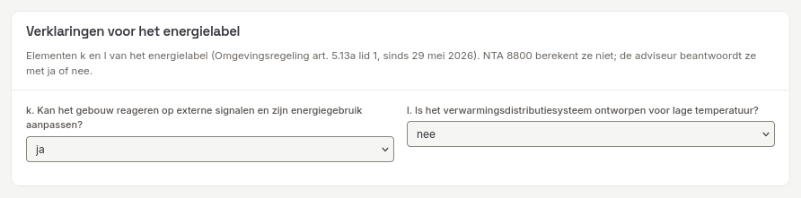
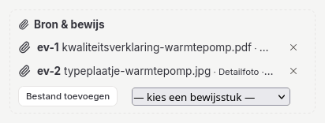

# 7. Herlabelen, registratie en dossier

## Registratiegegevens

De registratiegegevens staan in werkstap 10 **Registratie**, in het formulier onder de gereedheid en het rekenprogramma. (Tot het UI-herontwerp stonden ze in *Projectgegevens*; dat venster verwijst nu naar de stap Registratie.) Ze worden bewaard in het projectblok `registration`. Alle velden zijn optioneel: de kern meldt wat nog ontbreekt. Het gaat om:
- **Gebouw:**
  - doel (toets Bbl, oplevering, bestaande bouw);
  - opnametype en representativiteit;
  - adres en BAG-id;
  - bouwjaar en gebouwtype.
- **Partijen en data:**
  - opdrachtgever en certificaatnummer;
  - opnemend en registrerend adviseur, elk met vakbekwaamheidsnummer;
  - opname- en registratiedatum.
- **Berichttype:** `regular`, `relabel` (herlabelen) of `replacement` (vervanging van een onjuist label binnen 24 maanden, BRL 9500-W p. 24–25).
- **WLC-GWP:** voor nieuwe gebouwen boven 1000 m² bij een toets Bbl vanaf 1-1-2028 en de oplevering daarna (BRL 9500-W p. 18, 21, 62).
- **Vorige labelklasse:** alleen voor de plausibiliteitscontrole.
- **Verklaringen voor het energielabel:** de elementen k en l van het label (Omgevingsregeling art. 5.13a lid 1, sinds 29 mei 2026). NTA 8800 berekent ze niet; de adviseur beantwoordt ze met ja of nee:
  - *k. Kan het gebouw reageren op externe signalen en zijn energiegebruik aanpassen?*
  - *l. Is het verwarmingsdistributiesysteem ontworpen voor lage temperatuur?*

  Bij een registratiedatum vanaf 29 mei 2026, of zonder datum, zijn beide verplicht. Een onbeantwoorde vraag geeft *Verklaring k (reageren op externe signalen) ontbreekt* of *Verklaring l (afgiftesysteem voor lage temperatuur) ontbreekt*, en het dossier is dan niet compleet. Het antwoord gaat mee in de labelgegevens van de kern, het rekenrapport (tabel met de labelelementen) en het EP-Online-gegevensoverzicht. De *Checklist BRL 9500* toont beide antwoorden onder het EP-Online-gegevensoverzicht, in een eigen tabel, omdat het exportschema er geen veld voor heeft; een onbeantwoorde vraag staat daar als *niet beantwoord*. Bewaar de onderbouwing van het antwoord, zoals een productblad van de regeling of de ontwerptemperatuur van het afgiftesysteem, in het bewijsregister.

Wijzigingen in het formulier gaan pas in het project na **Opslaan**; **Verwerpen** zet het formulier terug. Zolang er niets is gewijzigd staan beide knoppen uit, met de tekst *Geen wijzigingen om op te slaan*. Een veld dat je invult en weer leegmaakt telt niet als wijziging. Ga je naar een andere stap voordat je opslaat, dan blijven de wijzigingen in het formulier staan; sluit je het projecttabblad of het programma, dan vraagt het programma eerst of je wilt sluiten zonder op te slaan. Slaat een andere stap intussen registratiegegevens op (zoals de vergelijking bij herlabelen), dan blijven jouw wijzigingen in het formulier staan. Het bewijsregister voegt per bewijsstuk samen: een koppeling of bestand dat je intussen vanuit het contextpaneel toevoegt, blijft na **Opslaan** bewaard naast jouw wijzigingen aan andere bewijsstukken, en een bewijsstuk dat je in het formulier verwijderde blijft weg. Is hetzelfde bewijsstuk zowel in het formulier als elders gewijzigd, dan houdt het formulier jouw versie en meldt het *Elders ook gewijzigd, uw niet-opgeslagen versie blijft staan* met de bestandsnaam; controleer dat bewijsstuk vóór **Opslaan**, of kies **Verwerpen** om de opgeslagen versie over te nemen. Is de registratie opgeslagen met een andere rekenkernversie, dan blijft **Opslaan** aan met de tekst *Opgeslagen met een andere rekenkernversie; opslaan legt de huidige vast*: opslaan legt dan het programmakenmerk van de huidige rekenkern vast.

**Ingelezen gegevens.** Bij registratie moet blijken of de adviseur gegevens met een ander hulpmiddel in het programma heeft ingelezen, en met welk hulpmiddel (BRL 9501 van 29-05-2026, §4.3.1, opmerking, p. 8). Automatisch inlezen mag niet: elke import in dit programma start de adviseur zelf. De UNIEC3- en VABI-import schrijven daarom een regel in het importlogboek van het project (`importLog`, met hulpmiddel, bestandsnaam, tijdstip, SHA-256 van het bestand en de punten om na te lopen; zie [hoofdstuk 9](09-bestanden-en-uitwisseling.md)). De registratiecontrole en het rekenrapport tonen het resultaat in de regel *Gegevens ingelezen*: "nee", of "ja, met …". Het importlogboek telt niet mee als labelinvoer bij herlabelen.

Bij opslaan schrijft de app ook de identiteit van het rekenprogramma: naam, versie, kernversie en attestnummer (Omgevingsregeling art. 5.14 lid 1 onder b). Bij een herlabeling is dat anders: dan blijft de opgeslagen identiteit van de oorspronkelijke berekening staan en schrijft de app niet de huidige (BRL 9500-W §4.2.4, p. 24).

**Controles van de kern**
- **Termijn:** registratie binnen drie maanden na de opname, of zes bij seriematige projecten (BRL §4.2.5).
- **Detailopname:** bij toets Bbl en oplevering is een detailopname verplicht (BRL 9500-W §3.1).
- **BAG-id:** het BAG-id heeft 16 cijfers. Een woning vraagt een verblijfsobject, ligplaats of standplaats. Utiliteit mag ook een pand-id gebruiken (Omgevingsregeling art. 5.14 lid 1 onder a; Praktijkhandboek p. 46).
- **Eén label per adres:** de app houdt lokaal bij welke labels er in deze installatie geregistreerd zijn. Ze waarschuwt als hetzelfde adres al een geldig woninglabel heeft. Labels die buiten deze installatie zijn geregistreerd, kan ze niet zien.

**Status**
- `dossierComplete` geeft aan of het dossier compleet is.
- `readyForRegistration` is alleen waar als het dossier compleet is **en** het programma geattesteerd is (Omgevingsregeling art. 5.11 en 5.12 lid 2. Zolang er geen attestnummer is, blijft dit onwaar.

## Bewijsregister

Het bewijsregister staat in werkstap 10 **Registratie**, onder het registratieformulier. *Rapport & dossier › Checklist BRL 9500* toont het register ook, met **Bewerken in Registratie**. Leg per bestand vast:
- soort, bestandsnaam en SHA-256;
- datum, optioneel GPS;
- aanleverende partij en controlerende adviseur;
- de JSON-paden die het bestand onderbouwt, gescheiden door komma's (`/zones/0, /zones/1`).

Verwijs vanuit een bronveld naar een bewijsstuk met `evidence:<id>`. Dat hoeft niet met de hand:
- **Bron & bewijs** onder elke invoersectie heeft per bronveld een keuzelijst met de bewijsstukken. Kiezen zet de verwijzing in het bronveld: achter de tekst die er al stond (`tekening A-101; evidence:ev-2`), of als enige inhoud van een leeg bronveld. Met **Bestand toevoegen** zet je een nieuw bestand in het register en koppel je het direct op dezelfde manier.
- In het **contextpaneel** (tabblad *Eigenschappen*, dat opent zodra je een element selecteert) heeft een geselecteerd gebouwelement (zone, vlak, raam, koudebrug) een blok **Bron & bewijs**. Daar koppel je een tekening, foto of verklaring aan dat element (`linkedPaths`, bijvoorbeeld `/zones/@woonzone/surfaces/@gevel-noord`: zone en vlak op hun id). De koppeling blijft bij het element als je andere elementen verwijdert of verschuift. Een project uit een eerdere versie met koppelingen op positie (`/zones/0/surfaces/2`) krijgt bij het openen koppelingen op id.
- In de **basisopname** heeft elk onderdeel een blok **Foto's** (zie [hoofdstuk 2](02-basisopname.md)).

**Welke bestanden.** Het register neemt pdf, afbeeldingen (jpg, png, heic, webp, tiff, svg …), tekeningen (dwg, dxf, ifc), kantoordocumenten (doc(x), xls(x), odt, ods, rtf, txt, csv) en e-mails (msg, eml) op, tot **200 MB per bestand**. Een ander bestandstype of een groter bestand wordt geweigerd met een melding bij het invoerblok; het bestand wordt dan niet gelezen. Video's horen daarom niet in het register: maak er een foto of een korte beschrijving van. Voeg je in twee blokken tegelijk bestanden toe, dan krijgt elk bestand een eigen id en blijven tussentijdse wijzigingen in het registratieformulier bewaard. Staat een id na het openen van een (met de hand bewerkt) project dubbel in het register, dan krijgt het tweede bewijsstuk een nieuw id, met een notitie in de beschrijving.

De **Checklist BRL 9500** toont per bewijsstuk de kolom **Onderbouwt**: de gekoppelde invoer, met een knop naar de stap waar die invoer staat. Een bewijsstuk zonder koppeling krijgt "niet gekoppeld". Wijst een bronveld naar een bewijsstuk dat niet meer in het register staat, dan meldt de pagina dat. Hetzelfde geldt voor een koppeling naar een element of opname-onderdeel dat niet meer in het project staat; die koppeling krijgt "niet meer in het project".

Bij herlabelen heeft een bewijsstuk een **rol bij herlabelen**:
- offerte met opdracht;
- gespecificeerde factuur van de verbetering op dit adres;
- foto van PV of zonthermie met beschaduwing.

## Herlabelen (BRL 9500 bijlagen 6a/6b)

Herlabelen kan alleen bij bestaande bouw. Het geldt voor verbeteringen die binnen 24 maanden na de oorspronkelijke opnamedatum zijn aangebracht. Er wordt gerekend met dezelfde rekenkern en dezelfde opnamedatum (BRL 9500-W §4.2.3–4.2.4, p. 23–24; 9500-U p. 18–20).

**Werkwijze**
1. Bewaar na de oorspronkelijke registratie het projectbestand, met het EP-Online-nummer in de registratiegegevens. Dat bestand wordt het **origineel**.
2. Breng de verbeteringen aan in het project. Bewerk bestaande elementen en voeg geen nieuwe toe als het om een vervanging gaat.
3. Zet het berichttype op *herlabelen*. Vul in:
   - de verbeteringsdatum;
   - het oorspronkelijke certificaatnummer en EP-Online-nummer;
   - de **Rekenkernversie oorspronkelijke opname (herlabelen)**; zonder dit veld meldt de kern `original_kernel_version_required`;
   - eventueel de verwijzing naar het oorspronkelijke dossier;
   - bij gewijzigde PV of zonthermie het vinkje **PV of zonthermie exclusief en fysiek verbonden met dit gebouw (herlabelen)** (BRL 9500-W p. 23);
   - bij utiliteit het vinkje **Utiliteit: met opdrachtgever en stukken vastgesteld dat er geen 6b-wijzigingen zijn (herlabelen)** (BRL 9500-U p. 19).
4. Kies in stap 8 **Herlabelen** (BRL 9500 bijlage 6a/6b) het oorspronkelijke projectbestand. De stepper leidt daarna door vergelijking, wijzigingen, bewijsrollen en gereedheid.

**De vergelijking.** Het paneel deelt elke wijziging in:
- toegestaan (6a);
- niet toegestaan (6b);
- te beoordelen door de adviseur.

De indeling volgt W bijlage 6a/6b (p. 67–68) en U bijlage 6a/6b (p. 58–60):

| Wijziging | Woningen (W) | Utiliteit (U) |
|---|---|---|
| Geometrie, thermische grens, gebruiksoppervlakte | 6b | 6b |
| Ander systeemtype | 6b | 6b |
| Koeling aangebracht of verwijderd (ISSO 82.1 bijlage A, cluster 6, p. 210; ISSO 75.1 p. 216) | 6b | 6b |
| Isolatie en installaties, één op één | 6a | 6a |
| Gasgestookt warmwatertoestel vervangen door een elektrische boiler (ISSO 82.1 bijlage A, cluster 1, p. 209; ISSO 75.1 p. 215) | 6a | 6a |
| Energielabel van een voorraadvat of buffervat | 6a | 6a |
| Distributie, afgifte, regeling | volgt 6a per functie | 6b |
| PV of zonthermie: grootte, helling, oriëntatie | beoordelen | beoordelen |
| g-waarde van beglazing | 6a | 6a |
| Luchtdichtheid of infiltratie (qv10; staat in geen van de bijlagen) | beoordelen | beoordelen |
| Verlichting (staat in geen van de bijlagen) | beoordelen | beoordelen |

Een andere wissel van tapwatertoestel, bijvoorbeeld een gastoestel door een warmtepomp, blijft een systeemwijziging (6b). Een naam of omschrijving die alleen ter weergave dient, telt niet als wijziging; het energielabel van een vat wel, want dat bepaalt het stilstandsverlies.

**Bewaren.** De vergelijking en het originele bestand worden bij de registratie bewaard (`registration.relabelComparison`). Na een latere projectwijziging staat er een melding dat de vergelijking verouderd is; vergelijk dan opnieuw.

**Controle bij registratie.** De kern vertrouwt de bewaarde uitkomst niet:
- **Echtheid van het origineel:** ze toetst het origineel aan zijn SHA-256 en aan het EP-Online-nummer, de certificaathouder en de opnamedatum in de registratie.
- **Opnieuw vergelijken:** ze vergelijkt opnieuw en gebruikt die uitkomst.
- **Actualiteit:** ze blokkeert als de huidige invoer sinds de vergelijking is gewijzigd (`relabel_comparison_outdated`).
- **Overige eisen:**
  - dezelfde certificaathouder;
  - een bewijsstuk met de rol offerte of factuur;
  - bij PV of zonthermie een foto en een bevestiging van de fysieke aansluiting;
  - bij utiliteit een bevestiging dat er geen 6b-wijzigingen zijn (U p. 19).

**Oude projecten.** Herlabelprojecten van vóór deze regels worden bij het openen eenmalig omgezet. Facturen zonder rol worden "te beoordelen" en tellen nog niet als bewijs. Een melding noemt de velden die nog ontbreken.

**Privacy.** Het projectbestand bevat het volledige origineel, met adres en opdrachtgever. Deel het alleen binnen het dossier van de certificaathouder.

## Projectdossier

Kies in *Rapport & dossier › Checklist BRL 9500* of *› Exports* **Projectdossier exporteren (ZIP)**. In de desktopapp kies je de plek in een opslagvenster; de browser downloadt het bestand. De ZIP bevat:

| Bestand | Inhoud |
|---|---|
| `project.oes.json` | het project, zonder het opgeslagen origineel |
| `kernel-output.json` | de volledige kernuitvoer |
| `ep-online-gegevensoverzicht.json` | de gegevens zoals EP-Online ze publiceert (veldnamen van het openbare exportschema `EpbdExportTypesV4`), om het geregistreerde label achteraf te controleren; **geen registratiebestand** |
| `rekenrapport.html` | het NTA-rekenrapport |
| `basisopname-output.json` | de opname-uitkomst, bij een basisopname |
| `herlabel-vergelijking.json` | de vergelijking, met de uitkomst van de nieuwe kernvergelijking (`kernelRecheck`), bij herlabelen |
| `herlabel-origineel.oes.json` | het origineel, byte voor byte, bij herlabelen |
| bewijsbestanden | uit het bewijsregister |
| `dossier-checklist.json` | de volledigheidscontrole (BRL 9500 bijlage 3, p. 61–63) |
| `manifest.json` | moment, projectnaam, kernversie met normversie en invoervingerafdruk, attestatus, per bestand pad, SHA-256 en grootte, de inhoudsopgave van het bewijs (`evidence`: per bewijsstuk soort, bestandsnaam, SHA-256, datum, pad in de ZIP, controleur en de invoer die het onderbouwt), de ontbrekende bewijsstukken (`missingEvidence`) en de checklist |

**Bestandsnamen en grootte.** Een bewijsbestand staat in de ZIP als `evidence/<id>-<bestandsnaam>`. Tekens die niet in een bestandsnaam horen worden een streepje; de extensie blijft staan als een lange naam wordt ingekort. Zouden twee bewijsstukken dezelfde naam krijgen, dan krijgt het tweede een volgnummer (`-2`), zodat geen bestand een ander overschrijft en de SHA-256 in het manifest klopt. Foto's, pdf's en andere al gecomprimeerde bestanden gaan ongecomprimeerd in de ZIP. Een dossier van meer dan **2 GB** wordt niet aangemaakt: de app meldt dat en noemt de grootte. Kan de desktopapp het dossier niet wegschrijven (schijf vol, geen schrijfrechten), dan verschijnt de foutmelding; het dossier geldt dan niet als geëxporteerd.

**Checklist.** De checklist hangt af van het doel, het opnametype, de representativiteit en herlabelen. Bij een basisopname toetst ze de redenen voor de toegepaste standaardwaarden. Rapport & dossier › Checklist BRL 9500 toont dezelfde checklist als de export. Terwijl de berekening loopt, staan punten op "bezig"; in een export komt die status nooit voor.

**EP-Online.** De app kan een label niet zelf registreren. Het uploadformaat van EP-Online is niet openbaar en is alleen voor geattesteerde rekenprogramma's via RVO verkrijgbaar. Het gegevensoverzicht in de ZIP gebruikt de veldnamen van het openbare exportschema, zodat u na registratie kunt nagaan of EP-Online dezelfde waarden toont als de berekening. `missingRequired` noemt de velden die voor een registratie nog ontbreken, zoals de registratiedatum of het certificaathoudernummer. Het blok `berekening` noemt het rekenprogramma met zijn versie, de rekenkernversie, de uitgave van NTA 8800 en het attestnummer (zolang er geen attest is: "nog niet toegekend").

**Bewaren.** Bewaar het dossier en het databestand vijftien jaar (Praktijkhandboek p. 47). Dat is een taak van de certificaathouder.
