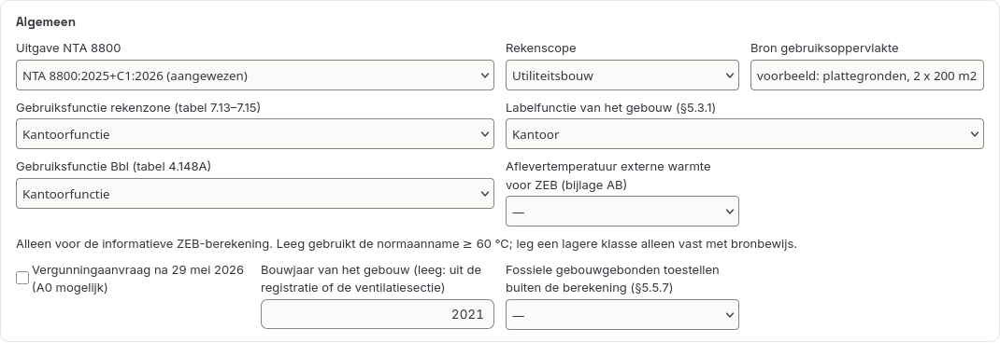
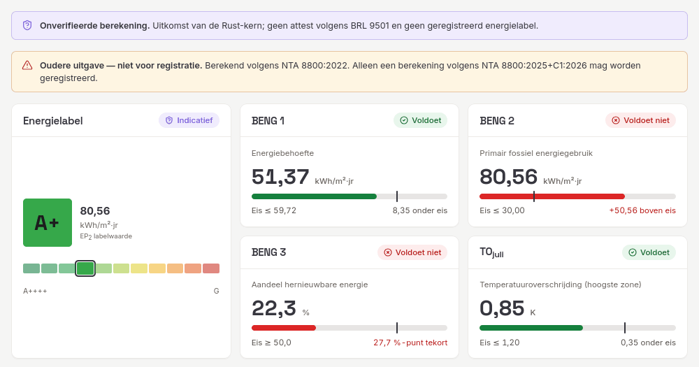

# 10. Normversies

Het programma rekent standaard volgens de aangewezen uitgave, **NTA 8800:2025+C1:2026**. Een project kan ook in een oudere uitgave rekenen: NTA 8800:2024 (met INT-V1:2024), 2023, 2022 of 2020+A1. Dat is bedoeld om een oude berekening na te rekenen of uitkomsten tussen uitgaven te vergelijken. De technische verantwoording, met elk schakelpunt en zijn paginaverwijzing, staat in [`docs/nta8800-normversies.md`](../nta8800-normversies.md).

## Een uitgave kiezen

- **Per project.** Op de stap **Project**, in het blok *Algemeen* van de NTA-invoer, staat de keuzelijst *Uitgave NTA 8800*. Een project zonder gekozen uitgave rekent in de aangewezen uitgave; de keuzelijst toont die dan ook. Een andere keuze opent eerst het venster **Uitgave van NTA 8800 wijzigen** (zie hieronder). Wat je daar bevestigt, gaat zoals elke wijziging eerst in het concept en geldt na **Toepassen** in de toepasbalk.
- **Voor nieuwe berekeningen.** Onder *Instellingen › Berekening* kies je de uitgave waarmee **NTA-invoer starten** een nieuw concept begint. Bestaande projecten houden hun eigen uitgave.

## Wat er verandert als je de uitgave wijzigt

Kies je in de keuzelijst een andere uitgave, dan rekent de rekenkern het project in de huidige en in de gekozen uitgave door. Het venster **Uitgave van NTA 8800 wijzigen** toont daarna, per groep, welke invoer de gekozen uitgave:
- **weigert**, bijvoorbeeld de wandhoogte boven maaiveld van een kruipruimte (8.47) bij de overstap van 2022 naar 2025+C1;
- **extra nodig heeft**, bijvoorbeeld diezelfde wandhoogte bij de overstap terug naar 2022, of de brontemperatuur met bewijs van een grondwaterwarmtepomp vanaf 2023;
- **niet gebruikt**, zoals een keuze die alleen in een andere uitgave een route heeft;
- **anders leest**, zoals *biomassa boven de grens*, waarvan de grens per uitgave verschilt;
- en welke **nieuwe waarschuwingen** de gekozen uitgave geeft.

Elke regel noemt de melding, het invoerpad, het omschakelpunt uit [`docs/nta8800-normversies.md`](../nta8800-normversies.md) (bijvoorbeeld "Punt 59") en wat je eraan kunt doen. Met **Ga naar** sluit je het venster zonder de uitgave te wijzigen en ga je naar het veld. Onderaan staat het aantal omschakelpunten zonder eigen invoer: daar veranderen alleen getallen of routes, zoals de CO₂-factoren van tabel 5.3.

Je hebt drie knoppen:
- **Annuleren** laat alles zoals het was.
- **Alleen uitgave wijzigen** zet alleen de uitgave om. De rest van de invoer blijft staan; de rekenkern meldt daarna elke afwijking afzonderlijk.
- **Automatisch aanpassen en wijzigen** verschijnt als er veilige aanpassingen zijn. Die knop zet de uitgave om en voert alleen mechanische aanpassingen uit: een geweigerd veld verwijderen, een keuze uitzetten die de gekozen uitgave niet kent. De beproevingsnorm van het testrapport voor tabel 9.28 past het programma niet aan: die zegt volgens welke norm de COP is gemeten en is dus bewijs. Het venster noemt de norm die de gekozen uitgave vraagt (NEN-EN 14511-2:2007 in 2020+A1 en 2022, :2022 daarna); pas het veld alleen aan als het testrapport die norm noemt, en kies anders een andere tabelrij. Een geweigerd veld dat de rekenkern daarna verplicht vindt, of waarvan het weglaten het blok onleesbaar maakt (zoals het piekvermogen per paneel als de PV-route op panelen staat), wordt niet verwijderd: dat blijft een keuze voor jou. Verplichte waarden vult het programma nooit zelf in; die blijven in de lijst staan. Bij een veld dat de gekozen uitgave extra vraagt, staat **Wijzigen en ga naar**: zo'n veld verschijnt vaak pas in die uitgave (zoals de hoogte h van 8.47 in 2022), dus die knop wijzigt eerst alleen de uitgave en gaat dan naar het veld. **Ga naar** bij de andere punten sluit het venster zonder de uitgave te wijzigen.

Beide wijzigknoppen zijn één stap in het concept: **Ongedaan maken** herstelt de uitgave en alle aanpassingen tegelijk. Is de rekenkern niet bereikbaar, dan meldt het venster dat de vergelijking niet beschikbaar is; je kunt de uitgave dan alleen omzetten.

De vergelijking is ook beschikbaar voor andere programma's, als `POST /v1/nta8800/project/editions/compare` in de HTTP-API en als MCP-tool `compare_project_editions` (zie [`docs/nta8800-api.md`](../nta8800-api.md)).

## Waarom een oudere uitgave niet registreerbaar is

Alleen een berekening volgens de aangewezen uitgave mag in EP-Online worden geregistreerd. Een uitkomst in een oudere uitgave krijgt daarom de status `calculated_legacy_edition`:
- het NTA-formulier toont bij de keuze "Oudere uitgave: de uitkomst dient alleen ter vergelijking en kan niet worden geregistreerd.";
- de projectstatus op de stap Project, het dashboard onder **Resultaten**, het rekenpaneel, de statusbalk en het NTA-rekenrapport melden "Oudere uitgave — niet voor registratie", met de uitgave waarin is gerekend;
- de registratiecontrole weigert het project met `legacy_edition_not_registrable`. De enige uitzondering is herlabelen in de uitgave van de oorspronkelijke berekening (zie hieronder).

## Invoer die alleen in een uitgave bestaat

Sommige invoer bestaat maar in een deel van de uitgaven. Het formulier toont die velden alleen onder de uitgaven die ze kennen. Voorbeelden:

| Invoer | Uitgaven | Waar |
|---|---|---|
| specifiek werkzame massa en dakoppervlak per ruimte (bijlage AA) | 2024 | Installaties › Koeling |
| keukenleiding ≤ 10 mm (tabel 13.2), afgifte-invoer van 2023 | 2023, 2022, 2020+A1 | Installaties › Warm tapwater, Verwarming, Koeling |
| massa per m² gebruiksoppervlakte (tabel 7.10) | 2022, 2020+A1 | Gebouw › Rekenzones, thermische massa |
| wandhoogte boven maaiveld bij kruipruimte of kelder (8.47) | 2022, 2020+A1 | Gebouw › Schil & ramen, vloeren op grond |
| elektrische boiler met geïsoleerde leidingen | 2022, 2020+A1 | Installaties › Warm tapwater |
| constante-lichtregeling (tabel 14.4) | 2022, 2020+A1 | Installaties › Verlichting |
| installatiejaar van de warmtepomp (9.85) | 2020+A1 | Installaties › Verwarming, opwekking |

Kies je met **Alleen uitgave wijzigen** een andere uitgave terwijl zo'n veld een waarde heeft, dan blijft de waarde staan en meldt het formulier dat alleen de genoemde uitgaven deze invoer kennen, met de knop **Verwijderen**. Laat je de waarde staan, dan weigert de rekenkern haar met `route_not_in_edition`.

Omgekeerd kent een oudere uitgave niet elke route van de aangewezen uitgave. Bijlage AA als bewijs van koelcapaciteit bestaat bijvoorbeeld niet in 2023, 2022 en 2020+A1, en een warmtepomp met een aanvoertemperatuur boven 55 °C volgens de forfaitaire tabellen bestaat niet in 2022. Zulke invoer geeft dan ook `route_not_in_edition`, met het pad van het veld en **Ga naar**.

## Andere onderdelen

- **Basisopname.** De opname rekent in de uitgave van het project. Het ISSO-opnameprotocol (7e druk) hoort bij de aangewezen uitgave; in een oudere uitgave is de uitkomst alleen ter vergelijking, met de melding `survey_protocol_edition_differs`.
- **Maatwerkadvies.** Het advies rekent in de uitgave van de basissituatie. Een maatregel die de uitgave verandert, is ongeldig.
- **Herlabelen.** De vergelijking rekent in de uitgave van het **oorspronkelijke** project. Een andere uitgave in het huidige project telt als niet toegestane wijziging.
- **Diagnoses en de constructie-editor.** De rekenhulpen onder Installaties (warmtepompen, ketels, BACS) en de U/R_c-berekening in de constructie-editor rekenen in de uitgave van het project, zowel in de desktopapp als in de browser.
- **Bestanden.** De uitgave staat in het projectbestand (`ntaCalculation.normVersion`). Een project zonder dat veld rekent in de aangewezen uitgave; de invoervingerafdruk blijft daardoor gelijk.
